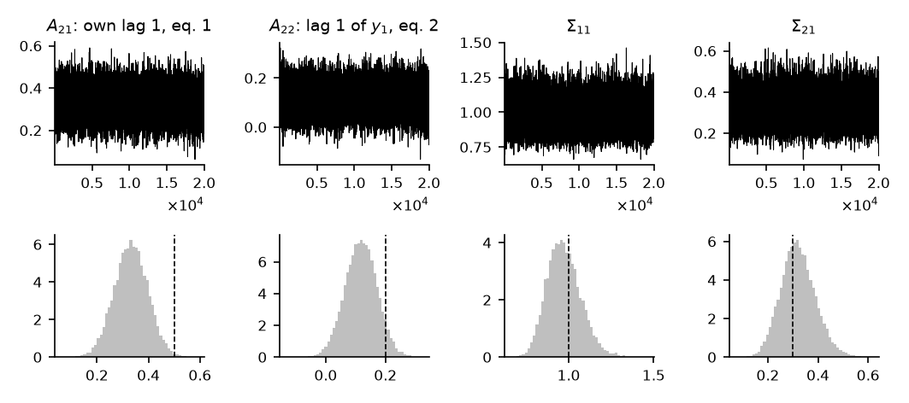

# How to Estimate a VAR by Gibbs Sampling

*Code: [`guide.py`](guide.py), with
[`bvt.samplers.var_coef_joint`](../../src/bvar_toolkit/samplers/_var_coef_joint.py),
[`bvt.diag.inefficiency_factor`](../../src/bvar_toolkit/diag/_inefficiency_factor.py),
[`bvt.diag.mcse`](../../src/bvar_toolkit/diag/_mcse.py) and
[`bvt.diag.geweke`](../../src/bvar_toolkit/diag/_geweke.py). Method:
[Chan (2027)](https://github.com/joshuaccchan/bvar-toolkit/blob/main/CITING.md#chan-2027)
and [Geweke (1992)](https://github.com/joshuaccchan/bvar-toolkit/blob/main/CITING.md#geweke-1992).
MATLAB version: [the same guide in bvar-toolkit](https://github.com/joshuaccchan/bvar-toolkit/tree/main/guides/gibbs_sampler).*

A Gibbs sampler draws the unknowns of a model in blocks, each from its distribution given the data
and the current values of the other blocks, and repeats. In
[How to Draw the VAR Coefficients under the Minnesota Prior](../coefficient_draw/) the error
covariance matrix is replaced by an estimate, and the coefficients are drawn given it. Here
$`\boldsymbol{\Sigma}`$ is unknown as well, with an inverse-Wishart prior, and the sampler
alternates between two blocks: the coefficients given $`\boldsymbol{\Sigma}`$, drawn as in that
guide, and $`\boldsymbol{\Sigma}`$ given the coefficients. We run it on the VAR(2) of the earlier
guides, check the chain with the diagnostics of `bvt.diag`, and verify the sampler under the
natural conjugate prior, whose posterior is known in closed form.

To print the numbers and draw the figure first, run from the root of the repository, after
`pip install -e .`:

```
python guides/gibbs_sampler/guide.py
```

## The Model and Its Priors

The VAR is $`\mathbf{y} = \mathbf{X}\boldsymbol{\beta} + \boldsymbol{\varepsilon}`$ with
$`\boldsymbol{\varepsilon} \sim \mathcal{N}(\mathbf{0}, \mathbf{I}_T \otimes \boldsymbol{\Sigma})`$,
in the stacked form of [How to Stack the Equations of a VAR](../var_stacking/), or
$`\mathbf{Y} = \mathbf{Z}\mathbf{A} + \mathbf{U}`$ in the matrix form, with
$`\boldsymbol{\beta} = \mathrm{vec}(\mathbf{A})`$. The independent normal and inverse-Wishart prior
is

$$\boldsymbol{\beta} \sim \mathcal{N}(\boldsymbol{\beta}_0, \mathbf{V}), \qquad \boldsymbol{\Sigma} \sim \mathcal{IW}(\nu_0, \mathbf{S}_0),$$

with $`\boldsymbol{\beta}`$ and $`\boldsymbol{\Sigma}`$ independent a priori. The inverse-Wishart
density is proportional to
$`|\boldsymbol{\Sigma}|^{-(\nu_0 + n + 1)/2}\exp\left(-\frac{1}{2}\mathrm{tr}(\mathbf{S}_0\boldsymbol{\Sigma}^{-1})\right)`$,
and its mean is $`\mathbf{S}_0/(\nu_0 - n - 1)`$. We take $`\boldsymbol{\beta}_0 = \mathbf{0}`$ and
the Minnesota variances $`\mathbf{V}`$ of the second guide, with $`c_1 = 0.2^2`$, $`c_2 = 0.1^2`$
and $`c_3 = 10^2`$, and we set $`\nu_0 = n + 2`$ and
$`\mathbf{S}_0 = \mathrm{diag}(s_1^2, \ldots, s_n^2)`$, so that the prior mean of
$`\boldsymbol{\Sigma}`$ is the estimate that the second guide uses in its place. The data are
those of the earlier guides: three variables, two lags and $`T = 200`$.

## Step 1: Split the Unknowns into Blocks

Given $`\boldsymbol{\Sigma}`$, the VAR is a linear regression with a known error covariance
matrix, and given $`\boldsymbol{\beta}`$, the errors are known. The sampler therefore cycles
through two blocks:

1. $`(\boldsymbol{\beta} \mid \mathbf{y}, \boldsymbol{\Sigma})`$, a Gaussian distribution, from
   the second guide;
2. $`(\boldsymbol{\Sigma} \mid \mathbf{y}, \boldsymbol{\beta})`$, an inverse-Wishart
   distribution.

## Step 2: Derive the Conditional Distributions

**The coefficients.** Given $`\boldsymbol{\Sigma}`$, the posterior of $`\boldsymbol{\beta}`$ is
that of the second guide, with precision
$`\mathbf{K} = \mathbf{V}^{-1} + \boldsymbol{\Sigma}^{-1} \otimes \mathbf{Z}'\mathbf{Z}`$ evaluated
at the current $`\boldsymbol{\Sigma}`$, and
[`bvt.samplers.var_coef_joint`](../../src/bvar_toolkit/samplers/_var_coef_joint.py) takes one draw.

**The covariance matrix.** Given $`\boldsymbol{\beta}`$, the residuals
$`\mathbf{U} = \mathbf{Y} - \mathbf{Z}\mathbf{A}`$ are known. The likelihood in the trace form of
the first guide, times the prior density, gives

$$p(\boldsymbol{\Sigma} \mid \mathbf{y}, \boldsymbol{\beta}) \propto |\boldsymbol{\Sigma}|^{-\frac{T}{2}}\exp\left(-\frac{1}{2}\mathrm{tr}(\boldsymbol{\Sigma}^{-1}\mathbf{U}'\mathbf{U})\right) \times |\boldsymbol{\Sigma}|^{-\frac{\nu_0 + n + 1}{2}}\exp\left(-\frac{1}{2}\mathrm{tr}(\mathbf{S}_0\boldsymbol{\Sigma}^{-1})\right),$$

the kernel of an inverse-Wishart density:

$$(\boldsymbol{\Sigma} \mid \mathbf{y}, \boldsymbol{\beta}) \sim \mathcal{IW}(\nu_0 + T, \mathbf{S}_0 + \mathbf{U}'\mathbf{U}).$$

The toolkit's `bvt.Stream(rng).iwishrnd(S, nu)` draws from $`\mathcal{IW}(\nu, \mathbf{S})`$ in this
parameterization.

## Step 3: Write the Loop

```python
nu0, S0 = n + 2, np.diag(s2)       # Sig ~ IW(nu0, S0), with prior mean S0
iV = sp.diags_array(1 / V)         # beta ~ N(0, V), the Minnesota variances
nsim, burnin = 20000, 1000
Sig = S0                           # the starting value
store_A, store_Sig = np.zeros((nsim, k, n)), np.zeros((nsim, n, n))
for isim in range(burnin + nsim):
    A = bvt.samplers.var_coef_joint(Y, Z, Sig, np.ones(T), iV, rng=rng)[0]   # beta given Sig
    U = Y - Z @ A
    Sig = bvt.Stream(rng).iwishrnd(S0 + U.T @ U, nu0 + T)                   # Sig given beta
    if isim >= burnin:
        store_A[isim - burnin] = A
        store_Sig[isim - burnin] = Sig
```

The chain starts from $`\boldsymbol{\Sigma} = \mathbf{S}_0`$, and the first 1,000 iterations are
discarded as burn-in. `var_coef_joint` forms $`\mathbf{Z}'\mathbf{Z}`$ at every call, since in
models with stochastic volatility its weights change from one call to the next. With constant
weights, as here, a sampler for a large VAR can form $`\mathbf{Z}'\mathbf{Z}`$ and
$`\mathbf{Z}'\mathbf{Y}`$ once, before the loop.

## Step 4: Check the Chain

In Figure 1, the draws fluctuate around a stable level throughout, with no drift. The inefficiency
factor of a parameter is approximately the number of draws that carry the information of one
independent draw. Computed by
[`bvt.diag.inefficiency_factor`](../../src/bvar_toolkit/diag/_inefficiency_factor.py) with
Bartlett weights up to lag 100, the inefficiency factors lie between 0.88 and 1.13 for the 21
coefficients and between 1.09 and 1.24 for the six distinct elements of $`\boldsymbol{\Sigma}`$,
so each posterior mean is estimated almost as precisely as from independent draws. The Monte Carlo
standard error of a posterior mean, which [`bvt.diag.mcse`](../../src/bvar_toolkit/diag/_mcse.py)
computes, is then close to the posterior standard deviation over $`\sqrt{20{,}000}`$.

The diagnostic of Geweke (1992), [`bvt.diag.geweke`](../../src/bvar_toolkit/diag/_geweke.py),
compares the mean of the first 10% of the chain with the mean of its second half; if the chain is
stationary, the statistic is approximately standard normal. It exceeds 1.96 in absolute value for
2 of the 27 parameters, against 1.35 expected by chance. Its largest value, 2.69, for the
coefficient on the first lag of variable 1 in equation 2, is within the usual range for 27 tests,
and ten runs of the sampler from other seeds give largest values between 1.53 and 3.70. With
inefficiency factors near one, the value of 2.69 is consistent with a chance event of this run.

| | True value | Posterior mean | 90% interval | Inefficiency factor | MCSE |
|---|---|---|---|---|---|
| Own first lag, equation 1 | 0.50 | 0.332 | (0.225, 0.438) | 0.91 | 0.0004 |
| First lag of variable 1, equation 2 | 0.20 | 0.118 | (0.029, 0.205) | 0.97 | 0.0004 |
| $`\Sigma_{11}`$ | 1.00 | 0.973 | (0.823, 1.145) | 1.11 | 0.0007 |
| $`\Sigma_{21}`$ | 0.30 | 0.321 | (0.212, 0.439) | 1.09 | 0.0005 |

The 90% intervals contain the true values for 25 of the 27 parameters.



*Figure 1: Top, the 20,000 draws of two coefficients and two elements of
$`\boldsymbol{\Sigma}`$ kept after the burn-in, in the order the sampler makes them. Bottom, their
histograms and the true values (dashed lines).*

## How We Check It

<details>
<summary>The same loop under the natural conjugate prior, whose posterior is known in closed form</summary>

Under the natural conjugate prior,
$`(\boldsymbol{\beta} \mid \boldsymbol{\Sigma}) \sim \mathcal{N}(\mathbf{0}, \boldsymbol{\Sigma} \otimes \mathbf{V}_{\mathbf{A}})`$
and $`\boldsymbol{\Sigma} \sim \mathcal{IW}(\nu_0, \mathbf{S}_0)`$, where the diagonal matrix
$`\mathbf{V}_{\mathbf{A}}`$ holds 100 for the intercept and $`0.2^2/(\ell^2 s_r^2)`$ for lag
$`\ell`$ of variable $`r`$. Two lines of the loop change: the prior precision of
$`\boldsymbol{\beta}`$ becomes $`\boldsymbol{\Sigma}^{-1} \otimes \mathbf{V}_{\mathbf{A}}^{-1}`$,
which depends on $`\boldsymbol{\Sigma}`$, and the prior of the coefficients enters the draw of
$`\boldsymbol{\Sigma}`$,

$$(\boldsymbol{\Sigma} \mid \mathbf{y}, \boldsymbol{\beta}) \sim \mathcal{IW}(\nu_0 + T + k, \mathbf{S}_0 + \mathbf{U}'\mathbf{U} + \mathbf{A}'\mathbf{V}_{\mathbf{A}}^{-1}\mathbf{A}).$$

The posterior is normal-inverse-Wishart in closed form, with
$`E(\mathbf{A} \mid \mathbf{y}) = \hat{\mathbf{A}} = \mathbf{K}_{\mathbf{A}}^{-1}\mathbf{Z}'\mathbf{Y}`$,
$`\mathbf{K}_{\mathbf{A}} = \mathbf{V}_{\mathbf{A}}^{-1} + \mathbf{Z}'\mathbf{Z}`$, and
$`E(\boldsymbol{\Sigma} \mid \mathbf{y}) = \hat{\mathbf{S}}/(\nu_0 + T - n - 1)`$,
$`\hat{\mathbf{S}} = \mathbf{S}_0 + \mathbf{Y}'\mathbf{Y} - \hat{\mathbf{A}}'\mathbf{K}_{\mathbf{A}}\hat{\mathbf{A}}`$.
Over 20,000 draws, the Gibbs means of the 27 parameters differ from these by at most 1.86 Monte
Carlo standard errors, and the standard deviations of the coefficient draws differ from the exact
posterior standard deviations by at most 1.2%. The check verifies the two draws of the loop,
`var_coef_joint` and the inverse-Wishart step, under a prior whose posterior is known; the
posterior under the independent prior of Step 3 has no closed form to compare with.

</details>

## Adapt It Yourself

The draws give the posterior of the parameters. How do you obtain the predictive distribution of
the next observation, $`\mathbf{y}_{T+1}`$?

<details>
<summary>Answer</summary>

For each kept draw of $`(\mathbf{A}, \boldsymbol{\Sigma})`$, draw
$`\mathbf{y}_{T+1}' = \mathbf{x}_{T+1}'\mathbf{A} + \boldsymbol{\varepsilon}_{T+1}'`$ with
$`\boldsymbol{\varepsilon}_{T+1} \sim \mathcal{N}(\mathbf{0}, \boldsymbol{\Sigma})`$, where
$`\mathbf{x}_{T+1}' = (1, \mathbf{y}_T', \mathbf{y}_{T-1}')`$. The draws of
$`\mathbf{y}_{T+1}`$ are a sample from its predictive distribution, which accounts for the
uncertainty about both $`\mathbf{A}`$ and $`\boldsymbol{\Sigma}`$.

```python
xT1 = np.concatenate([[1], Y[-1], Y[-2]])   # x_{T+1}' = (1, y_T', y_{T-1}')
yT1 = np.zeros((nsim, n))
for r in range(nsim):
    yT1[r] = xT1 @ store_A[r] + np.linalg.cholesky(store_Sig[r]) @ rng.standard_normal(n)
```

The predictive means are 3.24, 3.05 and 3.44, with 90% intervals (1.60, 4.88), (1.52, 4.57) and
(2.06, 4.83). `guide.py` checks the mean against the average of
$`\mathbf{x}_{T+1}'\mathbf{A}`$ over the draws, to within 0.0022, and the variance against the
average error variance plus the variance of $`\mathbf{x}_{T+1}'\mathbf{A}`$, to within 1.7%.

</details>

## Next

In [How to Choose the Shrinkage of a VAR by the Marginal Likelihood](../natural_conjugate_ml/) the
shrinkage of the natural conjugate prior of How We Check It is chosen from the data. Among the
examples of the MATLAB toolkit,
[ex13](https://github.com/joshuaccchan/bvar-toolkit/blob/main/examples/ex13_mcmc_diagnostics.m)
applies the same diagnostics to two samplers with stochastic volatility, and
[ex05](https://github.com/joshuaccchan/bvar-toolkit/blob/main/examples/ex05_var_csv.m) lets one
volatility path scale the whole covariance matrix of the VAR.

## Using This Method in Your Research

The independent normal and inverse-Wishart prior and its Gibbs sampler are standard, and
Chan (2027) gives a textbook treatment. The diagnostics of Step 4 are due to Geweke (1992).
[`CITING.md`](https://github.com/joshuaccchan/bvar-toolkit/blob/main/CITING.md) lists the paper
behind each function of the toolkit and how to cite the toolkit itself.

## References

Chan, J. C. C. (2027). *Bayesian Macroeconometrics: Methods and Applications*. Chapman &
Hall/CRC. [Code repository](https://github.com/joshuaccchan/bayesian-macroeconometrics)

Geweke, J. (1992). Evaluating the Accuracy of Sampling-Based Approaches to the Calculation of
Posterior Moments. In J. M. Bernardo, J. O. Berger, A. P. Dawid and A. F. M. Smith (Eds.),
*Bayesian Statistics 4*, 169-193. Oxford University Press.
[doi:10.1093/oso/9780198522669.003.0010](https://doi.org/10.1093/oso/9780198522669.003.0010)
