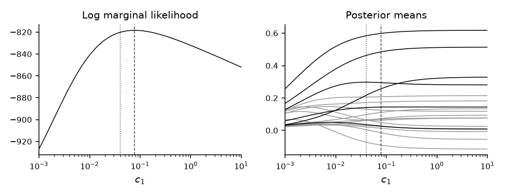

# How to Choose the Shrinkage of a VAR by the Marginal Likelihood

*Code: [`guide.py`](guide.py), with [`bvt.util.ldet`](../../src/bvar_toolkit/util/_ldet.py),
[`bvt.util.mgammaln`](../../src/bvar_toolkit/util/_mgammaln.py) and
[`bvt.ml.kron_bvar`](../../src/bvar_toolkit/ml/_kron_bvar.py). Method:
[Chan (2027)](https://github.com/joshuaccchan/bvar-toolkit/blob/main/CITING.md#chan-2027)
and
[Chan, Jacobi and Zhu (2020)](https://github.com/joshuaccchan/bvar-toolkit/blob/main/CITING.md#chan-jacobi-and-zhu-2020).
MATLAB version: [the same guide in bvar-toolkit](https://github.com/joshuaccchan/bvar-toolkit/tree/main/guides/natural_conjugate_ml).*

In [How to Draw the VAR Coefficients under the Minnesota Prior](../coefficient_draw/) and
[How to Estimate a VAR by Gibbs Sampling](../gibbs_sampler/), the shrinkage hyperparameters of
the Minnesota prior are set to commonly used values: $`c_1 = 0.2^2`$ for the own lags and
$`c_2 = 0.1^2`$ for the lags of other variables. Shrinkage hyperparameters can also be chosen
from the data, as the values at which the marginal likelihood, the density of the data with the
parameters integrated out, is largest. Under the natural conjugate prior, a single hyperparameter
controls the shrinkage of all lag coefficients, but the marginal likelihood is available in closed
form. We use this prior for the data of the earlier guides, compute its log marginal likelihood,
maximize it over the single hyperparameter, and see how the chosen shrinkage changes the
estimates.

To print the numbers and draw the figure first, run from the root of the repository, after
`pip install -e .`:

```
python guides/natural_conjugate_ml/guide.py
```

## The Model and Its Prior

The VAR is $`\mathbf{Y} = \mathbf{Z}\mathbf{A} + \mathbf{U}`$ in the matrix form of
[How to Stack the Equations of a VAR](../var_stacking/), where the rows of $`\mathbf{U}`$ are
independent $`\mathcal{N}(\mathbf{0}, \boldsymbol{\Sigma})`$ and
$`\boldsymbol{\beta} = \mathrm{vec}(\mathbf{A})`$. The natural conjugate prior is

$$(\boldsymbol{\beta} \mid \boldsymbol{\Sigma}) \sim \mathcal{N}(\mathbf{0}, \boldsymbol{\Sigma} \otimes \mathbf{V}_{\mathbf{A}}), \qquad \boldsymbol{\Sigma} \sim \mathcal{IW}(\nu_0, \mathbf{S}_0),$$

where $`\mathbf{V}_{\mathbf{A}}`$ is a diagonal $`k \times k`$ matrix. The prior variance of a
coefficient in equation $`i`$ is $`\sigma_{ii}`$, the error variance of that equation, times the
corresponding diagonal element of $`\mathbf{V}_{\mathbf{A}}`$. As in the third guide,
$`\nu_0 = n + 2`$ and $`\mathbf{S}_0 = \mathrm{diag}(s_1^2, \ldots, s_n^2)`$, where $`s_i^2`$ is
the residual variance of an AR(4) fit for variable $`i`$, so the prior mean of
$`\boldsymbol{\Sigma}`$ is $`\mathbf{S}_0`$. The data are those of the earlier guides: three
variables, two lags and $`T = 200`$.

## Step 1: Set the Prior Variances of the Coefficients

The diagonal of $`\mathbf{V}_{\mathbf{A}}`$ holds $`c_3 = 10^2`$ for the intercept and
$`c_1/(\ell^2 s_r^2)`$ for lag $`\ell`$ of variable $`r`$. In equation $`i`$, the prior variance
of the coefficient on lag $`\ell`$ of variable $`r`$ is then $`\sigma_{ii}c_1/(\ell^2 s_r^2)`$.
At the prior mean of $`\sigma_{ii}`$, which is $`s_i^2`$, this variance is $`c_1/\ell^2`$ for an
own lag, where $`r = i`$, and $`c_1 s_i^2/(\ell^2 s_r^2)`$ for a lag of another variable. These
are the Minnesota variances of the second guide with $`c_2 = c_1`$.

The restriction $`c_2 = c_1`$ comes from the Kronecker structure of the prior covariance matrix.
The same diagonal element of $`\mathbf{V}_{\mathbf{A}}`$ applies to lag $`\ell`$ of variable
$`r`$ in every equation. That coefficient is an own lag in equation $`r`$ and a lag of another
variable in the other equations, so the two groups share the hyperparameter $`c_1`$.

```python
nu0, S0 = n + 2, np.diag(s2)       # Sig ~ IW(nu0, S0)
c3 = 10**2                         # the intercepts

def VA(c1):
    """the diagonal of V_A"""
    return np.concatenate([[c3], np.kron(1 / np.arange(1, p + 1)**2, c1 / s2)])
```

Here `s2` holds $`s_1^2, \ldots, s_n^2`$, and `VA(c1)` returns the diagonal of
$`\mathbf{V}_{\mathbf{A}}`$ in the order of the columns of $`\mathbf{Z}`$: the intercept, the
first lags of the $`n`$ variables, then their second lags.

## Step 2: Compute the Marginal Likelihood in Closed Form

The marginal likelihood is the density of the data given $`c_1`$, with $`\mathbf{A}`$ and
$`\boldsymbol{\Sigma}`$ integrated out:

$$p(\mathbf{Y} \mid c_1) = \int\int p(\mathbf{Y} \mid \mathbf{A}, \boldsymbol{\Sigma})\, p(\mathbf{A}, \boldsymbol{\Sigma} \mid c_1)\, \mathrm{d}\mathbf{A}\, \mathrm{d}\boldsymbol{\Sigma}.$$

Like the likelihood, it conditions on the initial observations in $`\mathbf{Z}`$. Under the
natural conjugate prior, the integral has the closed form (Chan, 2027)

$$p(\mathbf{Y} \mid c_1) = \pi^{-\frac{nT}{2}} |\mathbf{V}_{\mathbf{A}}|^{-\frac{n}{2}} |\mathbf{K}_{\mathbf{A}}|^{-\frac{n}{2}} \frac{\Gamma_n(\hat{\nu}/2)}{\Gamma_n(\nu_0/2)} \frac{|\mathbf{S}_0|^{\nu_0/2}}{|\hat{\mathbf{S}}|^{\hat{\nu}/2}},$$

where $`\Gamma_n`$ is the multivariate gamma function, and
$`\mathbf{K}_{\mathbf{A}} = \mathbf{V}_{\mathbf{A}}^{-1} + \mathbf{Z}'\mathbf{Z}`$,
$`\hat{\mathbf{A}} = \mathbf{K}_{\mathbf{A}}^{-1}\mathbf{Z}'\mathbf{Y}`$,
$`\hat{\mathbf{S}} = \mathbf{S}_0 + \mathbf{Y}'\mathbf{Y} - \hat{\mathbf{A}}'\mathbf{K}_{\mathbf{A}}\hat{\mathbf{A}}`$
and $`\hat{\nu} = \nu_0 + T`$ are the parameters of the normal-inverse-Wishart posterior that the
third guide uses in its check. The function `ncp_lml` evaluates the formula in logs, which avoids
underflow and overflow, with [`bvt.util.ldet`](../../src/bvar_toolkit/util/_ldet.py) for the log
determinants, from Cholesky factors, and
[`bvt.util.mgammaln`](../../src/bvar_toolkit/util/_mgammaln.py) for $`\log\Gamma_n`$:

```python
def ncp_lml(Y, Z, VA, nu0, S0):
    """the log marginal likelihood under vec(A) | Sig ~ N(0, Sig kron diag(VA)) and
    Sig ~ IW(nu0, S0), with the posterior quantities Ahat, KA and Shat"""
    T, n = Y.shape
    KA = np.diag(1 / VA) + Z.T @ Z
    Ahat = np.linalg.solve(KA, Z.T @ Y)
    E = Y - Z @ Ahat                           # the residuals at the posterior mean
    # S0 + Y' Y - Ahat' KA Ahat, without the cancellation
    Shat = S0 + E.T @ E + Ahat.T @ (Ahat / VA[:, None])
    Shat = (Shat + Shat.T) / 2
    lml = (-n * T / 2 * np.log(np.pi) - n / 2 * (np.sum(np.log(VA)) + bvt.util.ldet(KA))
           + nu0 / 2 * bvt.util.ldet(S0) - (nu0 + T) / 2 * bvt.util.ldet(Shat)
           + bvt.util.mgammaln(n, (nu0 + T) / 2) - bvt.util.mgammaln(n, nu0 / 2))
    return lml, Ahat, KA, Shat
```

The function computes $`\hat{\mathbf{S}}`$ in the equivalent form
$`\mathbf{S}_0 + \hat{\mathbf{E}}'\hat{\mathbf{E}} + \hat{\mathbf{A}}'\mathbf{V}_{\mathbf{A}}^{-1}\hat{\mathbf{A}}`$,
with $`\hat{\mathbf{E}} = \mathbf{Y} - \mathbf{Z}\hat{\mathbf{A}}`$. This form avoids subtracting
two large matrices when the data are persistent or large in scale, and it keeps
$`\hat{\mathbf{S}}`$ positive definite.

As $`c_1`$ grows, two parts of the formula move in opposite directions. The lag coefficients in
$`\hat{\mathbf{A}}`$ move from zero toward least squares, the fit improves and
$`|\hat{\mathbf{S}}|`$ falls, which raises the marginal likelihood. At the same time
$`|\mathbf{V}_{\mathbf{A}}||\mathbf{K}_{\mathbf{A}}| = |\mathbf{I}_k + \mathbf{V}_{\mathbf{A}}\mathbf{Z}'\mathbf{Z}|`$
grows, which lowers it: a prior with larger variances places less mass near the coefficients that
fit the data. The maximum of the marginal likelihood balances the two effects.

## Step 3: Maximize over the Hyperparameter

Since $`c_1`$ is positive, we maximize over $`\log c_1`$ with SciPy's `minimize_scalar`, the
counterpart of MATLAB's `fminbnd`, for $`c_1`$ between $`10^{-3}`$ and 10, the range of the grid in
Figure 1:

```python
def lml(c1):
    return ncp_lml(Y, Z, VA(c1), nu0, S0)

lc = minimize_scalar(lambda lc: -lml(np.exp(lc))[0], bounds=(np.log(1e-3), np.log(10)),
                     method='bounded').x   # maximize over log(c1)
c1hat = np.exp(lc)
```

The maximum is at $`c_1 = 0.078`$, a prior standard deviation of $`\sqrt{c_1} = 0.279`$ for the
first own lags, against 0.2 under the commonly used $`c_1 = 0.2^2 = 0.04`$. The log marginal
likelihood is −818.37 at the maximum and −820.23 at $`c_1 = 0.04`$. Figure 1 plots it over a grid
of 161 values from 0.001 to 10. It rises steeply up to the maximum, from −926.91 at
$`c_1 = 0.001`$, and falls slowly after it, to −852.03 at $`c_1 = 10`$, where the posterior means
of the lag coefficients are within 0.0008 of their least squares estimates. On the grid the curve
has a single peak, at 0.079, the grid point nearest to the maximum that `minimize_scalar` finds.



*Figure 1: Left, the log marginal likelihood against $`c_1`$, on a logarithmic axis. Right, the
posterior means of the 18 lag coefficients, own lags in black and lags of other variables in
gray. The dashed lines mark the chosen value, $`c_1 = 0.078`$, and the dotted lines the commonly
used $`c_1 = 0.04`$.*

## Step 4: See What the Chosen Shrinkage Does

Under the chosen $`c_1`$, the posterior means of the first own lags are 0.295, 0.484 and 0.599,
against least squares estimates of 0.280, 0.514 and 0.618 and posterior means of 0.298, 0.463 and
0.584 under $`c_1 = 0.04`$. Against the true coefficients, the mean absolute error of the 18 lag
coefficients is 0.069 under the chosen $`c_1`$, 0.083 for least squares and 0.062 under
$`c_1 = 0.04`$.

We note two points. First, the marginal likelihood factors into one-step-ahead predictive
densities (Geweke, 2001),

$$p(\mathbf{Y} \mid c_1) = \prod_{t=1}^{T} p(\mathbf{y}_t \mid \mathbf{y}_1, \ldots, \mathbf{y}_{t-1}, c_1),$$

so maximizing it over $`c_1`$ maximizes the sum of the log predictive densities of the
observations, each evaluated one step ahead (Giannone, Lenza and Primiceri, 2015). The
factorization holds for a fixed prior. Here the variances $`s_i^2`$ in $`\mathbf{S}_0`$ and
$`\mathbf{V}_{\mathbf{A}}`$ come from the whole sample, and so does the choice of $`c_1`$, so the
criterion is an in-sample, empirical Bayes one. A real-time forecast evaluation would compute both
from the data available at each forecast origin. The estimation error of the coefficients is a
different criterion. Second, the choice is stable from one sample to the next. Over 200 additional
datasets generated from the same VAR, the chosen $`c_1`$ has a median of 0.078, and half the
values lie between 0.070 and 0.084. The chosen value gives a smaller error than least squares in
193 of the 200 datasets and a smaller error than $`c_1 = 0.04`$ in 33. The average errors are
0.052 under the chosen $`c_1`$, 0.060 for least squares and 0.048 under $`c_1 = 0.04`$.

## How We Check It

<details>
<summary>Bayes' theorem at two points, against the closed form</summary>

By Bayes' theorem, at every point $`(\mathbf{A}, \boldsymbol{\Sigma})`$,

$$\log p(\mathbf{Y} \mid c_1) = \log p(\mathbf{Y} \mid \mathbf{A}, \boldsymbol{\Sigma}) + \log p(\mathbf{A}, \boldsymbol{\Sigma} \mid c_1) - \log p(\mathbf{A}, \boldsymbol{\Sigma} \mid \mathbf{Y}, c_1),$$

where the prior and the posterior densities are normal-inverse-Wishart. If $`\hat{\mathbf{A}}`$,
$`\mathbf{K}_{\mathbf{A}}`$ or $`\hat{\mathbf{S}}`$ were wrong, the right side would change with
the point. [`bvt.ml.kron_bvar`](../../src/bvar_toolkit/ml/_kron_bvar.py) evaluates the right side
at $`\mathbf{A} = \hat{\mathbf{A}}`$ and $`\boldsymbol{\Sigma} = \hat{\mathbf{S}}/\hat{\nu}`$, and
over the grid of Figure 1 it agrees with `ncp_lml` to within 4.5e-13. At the true values of
$`\mathbf{A}`$ and $`\boldsymbol{\Sigma}`$ and the chosen $`c_1`$, the right side is −818.366767,
equal to the closed form to machine precision.

</details>

## Adapt It Yourself

The marginal likelihood also compares lag lengths. How do you choose $`p`$ from 1 to 4 together
with $`c_1`$?

<details>
<summary>Answer</summary>

For each $`p`$, maximize the log marginal likelihood over $`c_1`$, and take the $`p`$ with the
largest maximum. The comparison is valid only if every lag length explains the same observations
$`\mathbf{y}_1, \ldots, \mathbf{y}_T`$. The four presample rows
$`\mathbf{y}_{-3}, \ldots, \mathbf{y}_0`$ therefore supply the initial conditions for every
$`p`$, and the shorter lag lengths leave some of them unused.

```python
pmax = 4
lmlp, c1p = np.zeros(pmax), np.zeros(pmax)
for q in range(1, pmax + 1):
    Yq, Zq = bvt.util.build_lags(Yfull[4 - q:], q)   # the same T rows of Y for every q
    assert np.array_equal(Yq, Y), 'the lag lengths explain different observations'

    def VAq(c1):
        return np.concatenate([[c3], np.kron(1 / np.arange(1, q + 1)**2, c1 / s2)])

    res = minimize_scalar(lambda lc: -ncp_lml(Yq, Zq, VAq(np.exp(lc)), nu0, S0)[0],
                          bounds=(np.log(1e-3), np.log(10)), method='bounded')
    c1p[q - 1], lmlp[q - 1] = np.exp(res.x), -res.fun
```

The maximized log marginal likelihoods are −823.78, −818.37, −821.09 and −822.54 for $`p`$ from 1
to 4, so the choice is $`p = 2`$, the lag length of the data generating process. The chosen
$`c_1`$ falls as $`p`$ grows: 0.124, 0.078, 0.060 and 0.054.

</details>

## Next

The natural conjugate prior has one hyperparameter for the own lags and the lags of other
variables. The asymmetric conjugate prior of Chan (2022) gives the two groups separate
hyperparameters and keeps a closed-form marginal likelihood. On the data of this guide,
[`bvt.priors.acp_opt_kappa`](../../src/bvar_toolkit/priors/_acp_opt_kappa.py) chooses an own-lag
hyperparameter of 0.11 and an other-lag hyperparameter of 0.0083; 7 of the 12 coefficients on the
lags of other variables are zero in the data generating process.
[How Should I Choose the Shrinkage Hyperparameters of My BVAR?](../../tutorials/shrinkage/) makes
the same choice for a VAR of 21 US variables. Among the examples of the MATLAB toolkit,
[ex09](https://github.com/joshuaccchan/bvar-toolkit/blob/main/examples/ex09_marginal_likelihood.m)
evaluates the identity of How We Check It for a VAR with Student-$`t`$ errors, whose posterior is
not available in closed form, and compares three error specifications by their marginal
likelihoods.

## Using This Method in Your Research

Choosing hyperparameters by maximizing the marginal likelihood is an empirical Bayes method.
Giannone, Lenza and Primiceri (2015) give the hyperparameters of a BVAR a prior of their own and
base inference about them on their posterior, which is proportional to the marginal likelihood
times that prior. Carriero, Clark and Marcellino (2015) choose the overall tightness and the lag
length of a BVAR by maximizing the marginal likelihood over a grid, and find that the gains in
forecast accuracy over commonly used values are often modest. Chan, Jacobi and Zhu (2020)
maximize the marginal likelihood of large VARs under the natural conjugate prior by automatic
differentiation, and Chan (2027) gives a textbook treatment of the prior and its marginal
likelihood. [`CITING.md`](https://github.com/joshuaccchan/bvar-toolkit/blob/main/CITING.md) lists
the paper behind each function of the toolkit and how to cite the toolkit itself.

## References

Carriero, A., Clark, T. E. and Marcellino, M. (2015). Bayesian VARs: Specification Choices and
Forecast Accuracy. *Journal of Applied Econometrics*, 30(1): 46-73.
[doi:10.1002/jae.2315](https://doi.org/10.1002/jae.2315)

Chan, J. C. C. (2022). Asymmetric Conjugate Priors for Large Bayesian VARs. *Quantitative
Economics*, 13(3): 1145-1169. [doi:10.3982/QE1381](https://doi.org/10.3982/QE1381)

Chan, J. C. C. (2027). *Bayesian Macroeconometrics: Methods and Applications*. Chapman &
Hall/CRC. [Code repository](https://github.com/joshuaccchan/bayesian-macroeconometrics)

Chan, J. C. C., Jacobi, L. and Zhu, D. (2020). Efficient Selection of Hyperparameters in Large
Bayesian VARs Using Automatic Differentiation. *Journal of Forecasting*, 39(6): 934-943.
[doi:10.1002/for.2660](https://doi.org/10.1002/for.2660)

Geweke, J. (2001). Bayesian Econometrics and Forecasting. *Journal of Econometrics*, 100(1):
11-15. [doi:10.1016/S0304-4076(00)00046-4](https://doi.org/10.1016/S0304-4076(00)00046-4)

Giannone, D., Lenza, M. and Primiceri, G. E. (2015). Prior Selection for Vector Autoregressions.
*Review of Economics and Statistics*, 97(2): 436-451.
[doi:10.1162/REST_a_00483](https://doi.org/10.1162/REST_a_00483)
