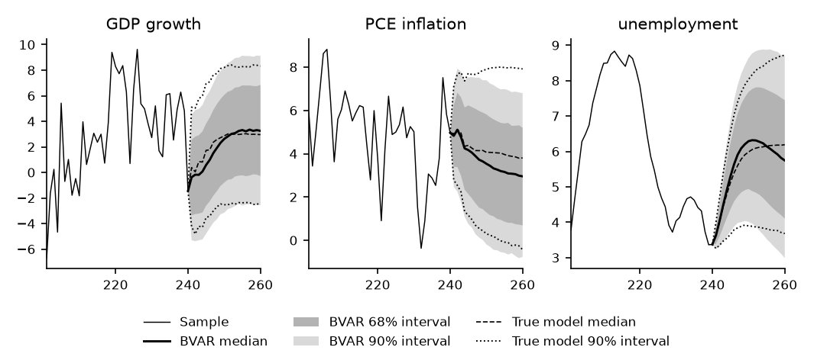
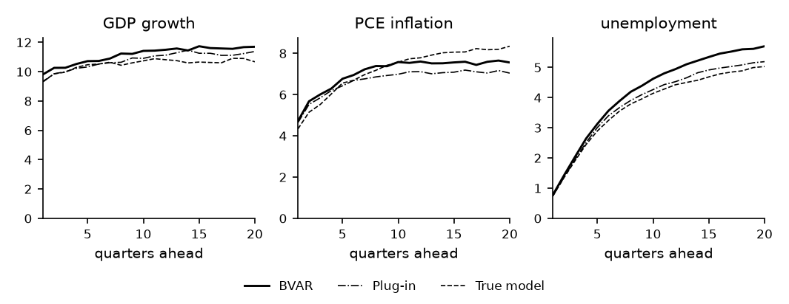

# How to Forecast with a Bayesian VAR

*Code: [`guide.py`](guide.py), with
[`bvt.util.simulate_var`](../../src/bvar_toolkit/util/_simulate_var.py),
[`bvt.forecast.predictive`](../../src/bvar_toolkit/forecast/_predictive.py) and
[`bvt.forecast.mixquantile`](../../src/bvar_toolkit/forecast/_mixquantile.py). Method:
[Chan (2027)](https://github.com/joshuaccchan/bvar-toolkit/blob/main/CITING.md#chan-2027).
MATLAB version: [the same guide in bvar-toolkit](https://github.com/joshuaccchan/bvar-toolkit/tree/main/guides/var_forecast).*

The forecast of a Bayesian VAR is the predictive distribution of the future values given the data.
It accounts for the shocks to come and for the uncertainty about the parameters. In this guide we
estimate a VAR on 240 quarters simulated from the true model of
[How to Simulate Data from an Estimated VAR](../var_simulation/), draw the parameters from their
posterior distribution, and simulate one future path for each draw. The point forecasts, the
intervals and the probabilities of events are summaries of the paths. Because the data are
simulated, we can compare these forecasts with those of the true model, made with the true
parameters. We also compare them with plug-in forecasts, which fix the parameters at their
posterior means.

To print the numbers and draw the figures first, run from the root of the repository, after
`pip install -e .`:

```
python guides/var_forecast/guide.py
```

## The Sample and the Prior

We first rebuild the true model of the series, the VAR(4) fitted by least squares to US real GDP
growth, PCE inflation and the unemployment rate from 1960 to 2019, with the residual covariance
matrix as its error covariance matrix. We then simulate the same sample of 240 quarters as in the
previous guide. In the last quarter of the sample, GDP growth is −1.45%, inflation is 4.97% and the
unemployment rate is 3.37%. We forecast the 20 quarters that follow.

The forecasting model is a VAR with the lag length of the true model, four, and the natural
conjugate prior of
[How to Choose the Shrinkage of a VAR by the Marginal Likelihood](../natural_conjugate_ml/):

$$(\boldsymbol{\beta} \mid \boldsymbol{\Sigma}) \sim \mathcal{N}(\mathbf{0}, \boldsymbol{\Sigma} \otimes \mathbf{V}_{\mathbf{A}}), \qquad \boldsymbol{\Sigma} \sim \mathcal{IW}(\nu_0, \mathbf{S}_0),$$

where $`\boldsymbol{\beta} = \mathrm{vec}(\mathbf{A})`$, and $`\mathbf{V}_{\mathbf{A}}`$,
$`\nu_0`$ and $`\mathbf{S}_0`$ are set as in that guide. The posterior is normal-inverse-Wishart:

$$(\boldsymbol{\Sigma} \mid \mathbf{Y}) \sim \mathcal{IW}(\hat{\nu}, \hat{\mathbf{S}}), \qquad (\boldsymbol{\beta} \mid \mathbf{Y}, \boldsymbol{\Sigma}) \sim \mathcal{N}(\mathrm{vec}(\hat{\mathbf{A}}), \boldsymbol{\Sigma} \otimes \mathbf{K}_{\mathbf{A}}^{-1}),$$

where $`\mathbf{K}_{\mathbf{A}}`$, $`\hat{\mathbf{A}}`$, $`\hat{\mathbf{S}}`$ and
$`\hat{\nu} = \nu_0 + T`$ are as given there.

## Step 1: Draw the Parameters from Their Posterior

A draw of the parameters takes two steps: $`\boldsymbol{\Sigma}`$ from its inverse-Wishart
posterior, then $`\mathbf{A}`$ given $`\boldsymbol{\Sigma}`$ from its Gaussian posterior. The
draws are independent, so no Markov chain is needed. The function `ncp_lml` of the natural
conjugate guide returns $`\hat{\mathbf{A}}`$, $`\mathbf{K}_{\mathbf{A}}`$ and $`\hat{\mathbf{S}}`$
with the log marginal likelihood. As in that guide, we choose the shrinkage hyperparameter $`c_1`$
by maximizing it:

```python
Y, Z = bvt.util.build_lags(data, p)               # the first four quarters are initial values
T, n = Y.shape
k = Z.shape[1]
s2 = bvt.priors.resid_var_ar4(data[:4], Y)        # AR(4) residual variances
nu0 = n + 2
S0 = np.diag(s2)                                  # Sig ~ IW(nu0, S0)
c3 = 10**2                                        # the intercepts


def VA(c1):
    """the diagonal of V_A"""
    return np.concatenate([[c3], np.kron(1 / np.arange(1, p + 1)**2, c1 / s2)])


lc = minimize_scalar(lambda lc: -ncp_lml(Y, Z, VA(np.exp(lc)), nu0, S0)[0],
                     bounds=(np.log(1e-3), np.log(10)), method='bounded',
                     options={'xatol': 1e-4}).x
c1 = np.exp(lc)                                   # the shrinkage chosen by the marginal likelihood
_, Ahat, KA, Shat = ncp_lml(Y, Z, VA(c1), nu0, S0)
nuhat = nu0 + T
R = 10000
LK = np.linalg.cholesky(KA)                       # KA = LK @ LK.T
Adraw = np.zeros((k, n, R))
Sdraw = np.zeros((n, n, R))
rng = np.random.default_rng(3)
stream = bvt.Stream(rng)                          # the draws of rng, under MATLAB's names
for r in range(R):
    Sdraw[:, :, r] = stream.iwishrnd(Shat, nuhat)   # Sig ~ IW(nuhat, Shat)
    Adraw[:, :, r] = Ahat + solve_triangular(LK.T, rng.standard_normal((k, n))) \
        @ np.linalg.cholesky(Sdraw[:, :, r]).T    # A given Sig
```

Let $`\mathbf{K}_{\mathbf{A}} = \mathbf{L}\mathbf{L}'`$, and let $`\mathbf{C}`$ be the lower
Cholesky factor of $`\boldsymbol{\Sigma}`$. With $`\mathbf{W}`$ a $`k \times n`$ matrix of
independent standard normals, the draw
$`\hat{\mathbf{A}} + (\mathbf{L}')^{-1}\mathbf{W}\mathbf{C}'`$ has covariance matrix
$`\boldsymbol{\Sigma} \otimes \mathbf{K}_{\mathbf{A}}^{-1}`$. The `iwishrnd` method of
[`bvt.Stream`](../../src/bvar_toolkit/_rng.py) uses the same parameterization of the
inverse-Wishart distribution, with mean $`\hat{\mathbf{S}}/(\hat{\nu} - n - 1)`$.

The marginal likelihood is largest at $`c_1 = 0.228`$, a prior standard deviation of 0.478 for the
first own lags, much weaker shrinkage than the commonly used $`c_1 = 0.2^2`$. The log marginal
likelihood is −1009.29 at the maximum and −1032.91 at $`c_1 = 0.04`$. The shrinkage lowers the
posterior mean of the first own lag of unemployment to 1.35, against a least squares estimate of
1.45 and a true value of 1.41. Of the 10,000 draws, two have a largest modulus above one, so they
imply an unstable VAR. We keep them, since they are draws from the posterior.

## Step 2: Simulate One Path for Each Draw

For each draw, [`simulate_var`](../../src/bvar_toolkit/util/_simulate_var.py) runs the VAR forward
from the last four quarters of the sample, with new Gaussian shocks:

```python
H = 20
ylast = data[-p:]                                 # the last four quarters, the oldest first
paths = np.zeros((H, n, R))
for r in range(R):
    paths[:, :, r] = bvt.util.simulate_var(Adraw[:, :, r], Sdraw[:, :, r], H, ylast, rng=rng)[0]
```

Each path combines one draw of the parameters with one draw of the future shocks. The paths are
therefore draws from the predictive distribution, the distribution of the future values given the
parameters averaged over the posterior:

$$p(\mathbf{y}_{T+1}, \ldots, \mathbf{y}_{T+H} \mid \mathbf{Y}) = \int p(\mathbf{y}_{T+1}, \ldots, \mathbf{y}_{T+H} \mid \mathbf{Y}, \mathbf{A}, \boldsymbol{\Sigma})\, p(\mathbf{A}, \boldsymbol{\Sigma} \mid \mathbf{Y})\, \mathrm{d}\mathbf{A}\, \mathrm{d}\boldsymbol{\Sigma}.$$

## Step 3: Read the Forecasts off the Paths

Quantiles of the paths at each horizon give the median and the intervals, and shares of the paths
give probabilities:

```python
# 5 x H x n: 90% and 68% bounds, median; 'hazen' is the definition of MATLAB's quantile
q = np.quantile(paths, [.05, .16, .5, .84, .95], axis=2, method='hazen')
fmean = paths.mean(axis=2)                        # the point forecast under squared error loss
pneg = np.mean(paths[0, 0] < 0)                   # P(GDP growth < 0) next quarter
```

Figure 1 shows the forecasts as fan charts, and Table 1 gives the medians and the 90% intervals at
four horizons. The intervals widen with the horizon as the shocks accumulate. The medians approach
the means of the VAR at the posterior means of the parameters: 2.85 for GDP growth, 2.98 for
inflation and 5.34 for unemployment. The mean of the paths, the point forecast that minimizes the
expected squared error, lies within 0.05 of the median at every horizon. The probability of
negative GDP growth next quarter is 0.55.

*Table 1: The forecasts of the BVAR: the median and, in parentheses, the 90% interval.*

| Horizon | GDP growth | PCE inflation | Unemployment |
|---|---|---|---|
| 1 quarter ahead | −0.38 (−5.31, 4.51) | 4.83 (2.46, 7.17) | 3.62 (3.24, 4.01) |
| 4 quarters ahead | 0.07 (−5.24, 5.28) | 4.24 (1.09, 7.38) | 4.90 (3.60, 6.24) |
| 8 quarters ahead | 1.92 (−3.66, 7.58) | 3.72 (0.13, 7.51) | 6.09 (4.00, 8.20) |
| 20 quarters ahead | 3.25 (−2.57, 9.13) | 2.96 (−0.76, 6.79) | 5.75 (2.99, 8.69) |



*Figure 1: The forecasts of the BVAR and of the true model for the 20 quarters after the sample,
with the last 40 quarters of the sample, against the quarter.*

## Step 4: Compare with the True Model and with Plug-in Forecasts

We also simulate 10,000 paths from the true parameters and 10,000 from the posterior means,
$`\hat{\mathbf{A}}`$ and $`\hat{\mathbf{S}}/(\hat{\nu} - n - 1)`$. The forecasts of the true model
use the true parameters, so they differ from those of the BVAR only because the parameters of the
BVAR are estimated. The plug-in forecasts use the estimates but do not account for the uncertainty
about them. The comparison shows that estimation error moves the forecasts away from those of the
true model, and that drawing the parameters widens the intervals to account for it, mostly at long
horizons for inflation and unemployment.

The shift is largest for GDP growth, whose medians lie below the true ones over the first eight
quarters, by up to 1.15. The medians of inflation and unemployment are within 0.85 of the true
ones.

Figure 2 shows the widths of the 90% intervals. One quarter ahead, the widths of the three sets of
intervals differ by at most 9%. After 20 quarters, the plug-in intervals for inflation are 16%
narrower than the true ones, because the VAR at the posterior means implies less long-run variation
in inflation than the true model. The intervals of the BVAR are 9.4% narrower.



*Figure 2: The width of the 90% interval against the horizon, for the BVAR, the plug-in forecasts
and the true model.*

## How We Check It

<details>
<summary>The one-step Student-t density, the mixture over the draws, and the true model</summary>

One quarter ahead, the predictive distribution has a closed form. It is multivariate Student-$`t`$
with $`\hat{\nu} - n + 1`$ degrees of freedom, location $`\hat{\mathbf{A}}'\mathbf{x}_{T+1}`$ and
scale matrix $`c\,\hat{\mathbf{S}}/(\hat{\nu} - n + 1)`$, where
$`\mathbf{x}_{T+1} = (1, \mathbf{y}_T', \ldots, \mathbf{y}_{T-3}')'`$ and
$`c = 1 + \mathbf{x}_{T+1}'\mathbf{K}_{\mathbf{A}}^{-1}\mathbf{x}_{T+1}`$. The 5%, 50% and 95%
quantiles of the paths lie within 0.038 predictive standard deviations of its quantiles. At every
horizon, the forecast given the parameters is Gaussian. The function
[`bvt.forecast.predictive`](../../src/bvar_toolkit/forecast/_predictive.py) computes its mean and
standard deviation for each draw, and
[`bvt.forecast.mixquantile`](../../src/bvar_toolkit/forecast/_mixquantile.py) computes the
quantiles of the mixture of the 10,000 Gaussians. At all 20 horizons, the quantiles of the paths
lie within 0.059 predictive standard deviations of those of the mixture. The means of the draws lie
within 0.024 posterior standard deviations of $`\hat{\mathbf{A}}`$ and within 0.38% of the
posterior mean of $`\boldsymbol{\Sigma}`$. The paths of the true model match its predictive means
and standard deviations, also from `bvt.forecast.predictive`, to within 0.022 standard deviations
and 1.8%. Dropping the two draws that imply an unstable VAR changes no quantile of Step 3 by more
than 0.007.

</details>

## Adapt It Yourself

The intervals of Figure 1 describe one quarter at a time. How do you compute the probability of a
recession in the next eight quarters, by the common rule of two consecutive quarters of negative
GDP growth?

<details>
<summary>Answer</summary>

Count the paths with two negative quarters in a row among their first eight:

```python
g = paths[:8, 0]                                  # GDP growth, 8 quarters by R paths
prec = np.mean(np.any((g[:7] < 0) & (g[1:] < 0), axis=0))   # two negative quarters in a row
```

The probability is 0.73 for the BVAR, against 0.56 for the true model and 0.73 for the plug-in
forecasts. The probabilities of negative growth in each of the eight quarters, between 0.29 and
0.55, do not determine it. It depends on the joint distribution of growth over the eight quarters,
which the paths provide.

</details>

## Next

[How to Evaluate Forecasts Out of Sample](../var_forecast_evaluation/) re-estimates the BVAR at
each quarter, as a forecaster would, and scores its forecasts against the outcomes. The series
[Getting Started with Bayesian VARs](../README.md#getting-started-with-bayesian-vars) covers the
estimation, and [Does Modeling the Volatility Improve My Forecasts?](../../tutorials/forecasting/)
forecasts with VARs on real data.

## Using This Method in Your Research

The predictive distribution integrates over the posterior of the parameters, so its intervals
account for the estimation error that plug-in forecasts leave out. Simulating one path per
posterior draw works for any model whose posterior can be sampled. With stochastic volatility,
each path also includes a simulated path of the volatility. Chan (2027) gives a textbook
treatment of forecasting with Bayesian VARs.
[`CITING.md`](https://github.com/joshuaccchan/bvar-toolkit/blob/main/CITING.md) lists the paper
behind each function of the toolkit and how to cite the toolkit itself.

## References

Chan, J. C. C. (2027). *Bayesian Macroeconometrics: Methods and Applications*. Chapman &
Hall/CRC. [Code repository](https://github.com/joshuaccchan/bayesian-macroeconometrics)
