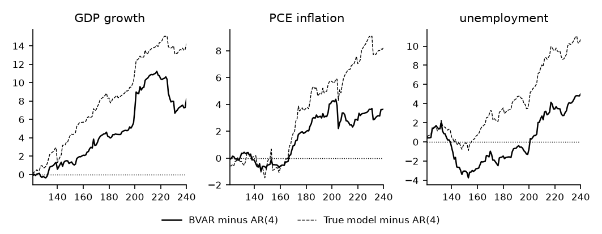

# How to Evaluate Forecasts Out of Sample

*Code: [`guide.py`](guide.py), with
[`bvt.forecast.predictive`](../../src/bvar_toolkit/forecast/_predictive.py) and
[`bvt.util.logsumexp`](../../src/bvar_toolkit/util/_logsumexp.py). Method:
[Chan (2027)](https://github.com/joshuaccchan/bvar-toolkit/blob/main/CITING.md#chan-2027).
MATLAB version: [the same guide in bvar-toolkit](https://github.com/joshuaccchan/bvar-toolkit/tree/main/guides/var_forecast_evaluation).*

A forecasting model is judged by the forecasts it would have made in the past, each from the data
available at the time. In this guide we evaluate the BVAR of
[How to Forecast with a Bayesian VAR](../var_forecast/) on the sample of the series. At the end of
each quarter from 120 to 239, we estimate it on the data up to that quarter and forecast one and
four quarters ahead. We score the point forecasts by the root mean squared forecast error, the
density forecasts by the log predictive likelihood, and the intervals by how often they contain
the outcomes. We use an AR(4) for each variable as the benchmark, and we also score the forecasts
of the true model, made with the true parameters. One quarter ahead, the forecasts of the BVAR are
more accurate than those of the AR(4) for all three variables. Four quarters ahead, they are more
accurate for GDP growth and unemployment.

To print the numbers and draw the figure first, run from the root of the repository, after
`pip install -e .`:

```
python guides/var_forecast_evaluation/guide.py
```

## The Forecast Origins and the Benchmark

The sample is the 240 quarters of the previous two guides. The first forecast origin is the end of
quarter 120, after 30 years of data, and the last is the end of quarter 239. The estimation sample
therefore grows by one quarter from one origin to the next. There are 120 forecasts one quarter
ahead and 117 four quarters ahead, since the sample ends with quarter 240.

Each AR(4) has the natural conjugate prior of the BVAR, applied to one variable at a time, so the
comparison with the BVAR measures what the lags of the other two variables add to the forecasts.

## Step 1: Forecast at Each Origin with the Data of the Time

At each origin, the function `ncp_forecast` at the top of `guide.py` repeats the steps of the
previous guide on the data up to the origin, `Yt`, and on nothing else:

```python
H, R = 4, 1000
origins = np.arange(120, Tall)                    # forecasts made at the end of quarters 120 to 239
no = origins.size
Yout = np.full((no, n, H), np.nan)                # the outcomes, NaN after the end of the sample
F = np.full((no, n, H, 3), np.nan)                # forecasts and scores: BVAR, AR(4), true model
LP, PIT = F.copy(), F.copy()
rng = np.random.default_rng(3)
for j in range(no):
    t = origins[j]
    Yt = data[:t]                                 # the data up to the origin, and nothing after it
    hmax = min(H, Tall - t)
    yout = np.full((H, n), np.nan)
    yout[:hmax] = data[t:t + hmax]
    Yout[j] = yout.T
    F[j, :, :, 0], LP[j, :, :, 0], PIT[j, :, :, 0] = ncp_forecast(Yt, yout, p, H, R, rng)
    for i in range(n):                            # an AR(4) for each variable
        F[j, i:i + 1, :, 1], LP[j, i:i + 1, :, 1], PIT[j, i:i + 1, :, 1] = \
            ncp_forecast(Yt[:, [i]], yout[:, [i]], p, H, R, rng)
    F[j, :, :, 2], LP[j, :, :, 2], PIT[j, :, :, 2] = gauss_forecast(Atrue, Sigtrue, Yt, yout)
```

The function `ncp_forecast` computes the AR(4) residual variances of the prior from `Yt`, chooses
$`c_1`$ by maximizing the marginal likelihood on `Yt`, draws the parameters 1,000 times and
forecasts. Computing the variances or $`c_1`$ once, from the whole sample, would make the
forecasts depend on the outcomes they are scored against. Given one column of the data, the same
function gives the forecasts of an AR(4) under the same prior, and `gauss_forecast` gives those of
the true model.

Scoring a density forecast requires the predictive density at the outcome, which the simulated
paths of the previous guide do not provide. Given the parameters, the forecast at every horizon is
Gaussian, with the mean and the standard deviation that
[`bvt.forecast.predictive`](../../src/bvar_toolkit/forecast/_predictive.py) computes. The
predictive density is therefore the average of these Gaussian densities over the draws, and so is
its value at the outcome. The last lines of `ncp_forecast` compute it:

```python
mu, sd = bvt.forecast.predictive(Ad, Sd, np.flipud(Yt[-p:]).T, H)   # R x n x H
z = (yout.T - mu) / sd
m = mu.mean(axis=0)                           # the mean of the mixture over the draws
lp = bvt.util.logsumexp(-np.log(sd) - z**2 / 2, 0) - np.log(R) - np.log(2 * np.pi) / 2
pit = stats.norm.cdf(z).mean(axis=0)
```

The predictive mean `m` is the point forecast. The variable `lp` is the log of the average density
at the outcome, computed with [`bvt.util.logsumexp`](../../src/bvar_toolkit/util/_logsumexp.py)
to avoid underflow. The variable `pit`, the probability integral transform (PIT), is the
predictive probability of a value below the outcome.

## Step 2: Score the Point Forecasts

The root mean squared forecast error (RMSFE) is the square root of the average squared difference
between the outcome and the point forecast. Table 1 gives the RMSFE of the BVAR and of the true
model relative to that of the AR(4). A ratio below one means more accurate forecasts than those of
the benchmark.

*Table 1: The RMSFE of the BVAR and of the true model relative to that of the AR(4).*

| Model and horizon | GDP growth | PCE inflation | Unemployment |
|---|---|---|---|
| BVAR, 1 quarter ahead | 0.93 | 0.97 | 0.96 |
| True model, 1 quarter ahead | 0.89 | 0.93 | 0.92 |
| BVAR, 4 quarters ahead | 0.93 | 1.03 | 0.83 |
| True model, 4 quarters ahead | 0.91 | 0.97 | 0.82 |

One quarter ahead, the BVAR is more accurate than the AR(4) for all three variables, and for each
it comes within 5% of the true model. Four quarters ahead, the largest gain from the lags of the
other variables is in unemployment, whose RMSFE is 17% below that of the AR(4) for the BVAR and
18% for the true model. The BVAR comes within 2% of the true model there. For GDP growth, the
RMSFE is 7% below that of the AR(4) for the BVAR and 9% for the true model. For inflation, the
three models are within 6% of one another four quarters ahead.

## Step 3: Score the Density Forecasts

The log predictive likelihood, or log score, of a forecast is `lp`, the log of the predictive
density at the outcome. It is high when the outcome falls where the forecast places much
probability, so it scores the whole predictive distribution, its center and its spread. A model
whose average log score is higher by 0.05 has a predictive density at the outcomes that is higher
by a factor of $`\mathrm{e}^{0.05} \approx 1.05`$, in the geometric mean. Table 2 compares the
average log scores with that of the AR(4).

*Table 2: The average log score of the BVAR and of the true model minus that of the AR(4).*

| Model and horizon | GDP growth | PCE inflation | Unemployment |
|---|---|---|---|
| BVAR, 1 quarter ahead | 0.068 | 0.030 | 0.042 |
| True model, 1 quarter ahead | 0.119 | 0.069 | 0.089 |
| BVAR, 4 quarters ahead | 0.070 | −0.028 | 0.179 |
| True model, 4 quarters ahead | 0.100 | 0.031 | 0.201 |

The log scores rank the models as the RMSFEs do. Figure 1 shows when the gains of the BVAR over
the AR(4) arise one quarter ahead. For GDP growth they accrue evenly to quarter 180, rise sharply
between quarters 195 and 215 and fall back in part after quarter 225. For inflation they accrue
between quarters 165 and 190, after which the two models score about the same, and for
unemployment they accrue after quarter 200.



*Figure 1: The cumulative sum of the log score of the BVAR and of the true model minus that of the
AR(4), one quarter ahead, against the quarter forecast.*

## Step 4: Check the Intervals

An interval is calibrated if it contains the outcome as often as its probability implies. The 90%
interval contains the outcome when the PIT lies between 0.05 and 0.95, so its coverage is the
share of PITs in that range:

```python
# the 90% coverage
cov90 = np.sum((PIT > .05) & (PIT < .95), axis=0) / np.sum(~np.isnan(PIT), axis=0)
```

One quarter ahead, the 90% intervals of the BVAR contain 93%, 89% and 95% of the outcomes for GDP
growth, inflation and unemployment. With 120 independent forecasts, a correct 90% interval
contains between 84% and 95% of the outcomes with probability 0.95, so these coverages are
consistent with calibrated intervals. Four quarters ahead, the coverage is 93%, 88% and 91%.
Consecutive four-quarter forecasts share three of their four future shocks, so their coverage
varies more than that range allows.

## How We Check It

<details>
<summary>The one-step Student-t density, and the number of draws</summary>

One quarter ahead, the predictive density has a closed form, the multivariate Student-$`t`$ of
[How to Forecast with a Bayesian VAR](../var_forecast/). Averaged over the 120 forecasts, the log
scores from the 1,000 draws match those of the Student-$`t`$ to within 0.0010, for the BVAR and
the AR(4), and every PIT matches to within 0.0121. The largest gap in a single log density, 0.052,
is for an outcome far in the tail, with a PIT of 0.009, and it falls to 0.005 with 20,000 draws.
At the first origin, four quarters ahead, the log densities and the PITs from 20,000 draws are
within 0.0051 and 0.0049 of those from 1,000.

</details>

## Adapt It Yourself

The coverage of the 90% intervals concerns only two quantiles of the predictive distribution. How
do you check the whole distribution?

<details>
<summary>Answer</summary>

If the forecasts are calibrated, the PITs are uniform between 0 and 1. Count them in ten bins of
width 0.1:

```python
counts = np.zeros((n, 10), dtype=int)
for i in range(n):                                # BVAR, one quarter ahead, ten bins
    counts[i] = np.histogram(PIT[:, i, 0, 0], bins=np.linspace(0, 1, 11))[0]
```

Each bin should hold 12 of the 120 PITs on average. The counts of the BVAR one quarter ahead range
from 6 to 22, and with uniform PITs a bin holds between 6 and 19 with probability 0.95. A
histogram that rises toward the middle would show intervals that are too wide, and a histogram
that rises toward the edges would show intervals that are too narrow.

</details>

## Next

[How to Choose the Lag Length and the Shrinkage for Forecasting](../var_lag_shrinkage/) compares
choices of the lag length and the shrinkage of the BVAR by their scores one quarter ahead.
[Does Modeling the Volatility Improve My Forecasts?](../../tutorials/forecasting/) evaluates VARs
with stochastic volatility on real data in the same way, by the same two scores.

## Using This Method in Your Research

Recursive evaluation out of sample, with the RMSFE for point forecasts and the log predictive
likelihood for density forecasts, is the standard way to compare forecasting models. Chan
(2027) gives a textbook treatment of both scores.
[`CITING.md`](https://github.com/joshuaccchan/bvar-toolkit/blob/main/CITING.md) lists the paper
behind each function of the toolkit and how to cite the toolkit itself.

## References

Chan, J. C. C. (2027). *Bayesian Macroeconometrics: Methods and Applications*. Chapman &
Hall/CRC. [Code repository](https://github.com/joshuaccchan/bayesian-macroeconometrics)
