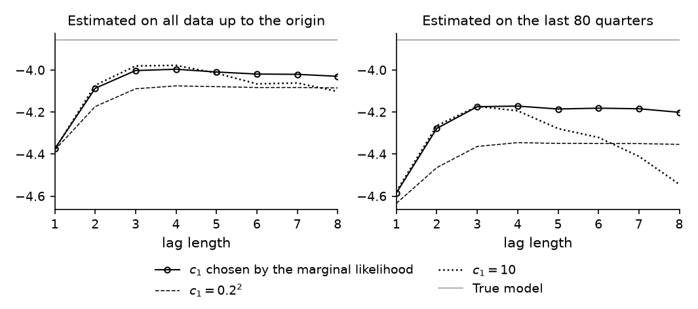

# How to Choose the Lag Length and the Shrinkage for Forecasting

*Code: [`guide.py`](guide.py), with [`bvt.util.build_lags`](../../src/bvar_toolkit/util/_build_lags.py),
[`bvt.util.ldet`](../../src/bvar_toolkit/util/_ldet.py) and
[`bvt.util.mgammaln`](../../src/bvar_toolkit/util/_mgammaln.py). Method:
[Chan (2027)](https://github.com/joshuaccchan/bvar-toolkit/blob/main/CITING.md#chan-2027).
MATLAB version: [the same guide in bvar-toolkit](https://github.com/joshuaccchan/bvar-toolkit/tree/main/guides/var_lag_shrinkage).*

Forecasting with a BVAR requires two settings: the lag length $`p`$ and the shrinkage
hyperparameter $`c_1`$ of the natural conjugate prior. The marginal likelihood is the product of
the one-quarter-ahead predictive densities of the observations (Geweke, 2001). Maximizing it over
the two settings therefore selects the specification that would have forecast best within the
sample (Giannone, Lenza and Primiceri, 2015).

In this guide we choose the two settings in this way at each forecast origin of
[How to Evaluate Forecasts Out of Sample](../var_forecast_evaluation/), and we score the forecasts
one quarter ahead. We compare them with 24 alternatives. Each has a fixed lag length between one
and eight, and a value of $`c_1`$ that is either chosen by the marginal likelihood at each origin
or set to the commonly used $`0.2^2`$ or to 10. The value 10 gives a nearly flat prior, under
which the posterior means are close to the least squares estimates. We make the comparison twice,
once with all the data up to each origin and once with only its last 80 quarters.

The forecasts made with the settings that maximize the marginal likelihood score almost as well as
the best of the alternatives. With $`c_1`$ chosen by the marginal likelihood, lags beyond the
fourth change the scores little. With $`c_1 = 10`$, these lags lower the scores, most of all with
80 quarters.

To print the numbers and draw the figure first, run from the root of the repository, after
`pip install -e .`:

```
python guides/var_lag_shrinkage/guide.py
```

## The Choices and the Scores

The sample, the forecast origins and the prior are those of the previous two guides: 240 simulated
quarters, origins at the end of quarters 120 to 239, and the natural conjugate prior with
$`\nu_0 = n + 2`$, $`\mathbf{S}_0 = \mathrm{diag}(s_1^2, \ldots, s_n^2)`$ and a prior variance of
$`10^2`$ for the intercepts. At each origin we estimate the BVAR on two windows: all the data up
to the origin, and the last 80 quarters. The last 80 quarters, 20 years of data, represent a short
sample. With eight lags, each equation then has 25 coefficients and 72 observations. In each
window, the first eight quarters serve as initial values for every lag length. The VARs of all lag
lengths are therefore fitted to the same observations, and their marginal likelihoods can be
compared. The variances $`s_i^2`$ come from AR(4) fits to the same observations.

We score each forecast by the log of the joint predictive density of the three variables at the
outcome, which we call the joint log score. One quarter ahead, the predictive distribution is the
multivariate Student-$`t`$ of [How to Forecast with a Bayesian VAR](../var_forecast/), so the
score requires no posterior draws. For given $`p`$ and $`c_1`$, the log marginal likelihood is the
sum of the same scores over the observations of the window, each computed from the posterior given
the observations before it:

$$\log p(\mathbf{Y}) = \sum_{t=1}^{T} \log p(\mathbf{y}_t \mid \mathbf{y}_1, \ldots, \mathbf{y}_{t-1}),$$

where both sides condition on the initial values.

## Step 1: Choose the Lag Length and the Shrinkage at Each Origin

At each origin and in each window, the function `choose_and_forecast` at the end of `guide.py`
maximizes the log marginal likelihood over $`c_1`$ for every lag length and computes the
forecasts. It uses the function `ncp_lml` of
[How to Choose the Shrinkage of a VAR by the Marginal Likelihood](../natural_conjugate_ml/):

```python
def choose_and_forecast(W, y1, pmax, c1fix):
    n = W.shape[1]
    ns = 1 + len(c1fix)
    ls = np.zeros((pmax, ns))
    se = np.zeros((n, pmax, ns))
    lml = np.zeros(pmax)
    c1 = np.zeros(pmax)
    s2 = bvt.priors.resid_var_ar4(W[pmax - 4:pmax], W[pmax:])   # AR(4) variances
    for p in range(1, pmax + 1):
        Y, Z = bvt.util.build_lags(W[pmax - p:], p)            # the same Y for every p
        VA = lambda c: np.concatenate([[10**2], np.kron(1 / np.arange(1, p + 1)**2, c / s2)])
        res = minimize_scalar(lambda lc: -ncp_lml(Y, Z, VA(np.exp(lc)), n + 2, np.diag(s2))[0],
                              bounds=(np.log(1e-3), np.log(10)), method='bounded')
        lml[p - 1] = -res.fun
        c1[p - 1] = np.exp(res.x)
        x = np.concatenate([[1.0], W[::-1][:p].ravel()])       # x_{t+1}
        cs = [c1[p - 1], *c1fix]
        for s in range(ns):
            _, Ahat, KA, Shat = ncp_lml(Y, Z, VA(cs[s]), n + 2, np.diag(s2))
            df = Y.shape[0] + 3                                # nuhat - n + 1
            m = x @ Ahat
            Psi = (1 + x @ np.linalg.solve(KA, x)) * Shat / df   # the Student-t forecast
            ls[p - 1, s] = mvt_logpdf(y1, m, Psi, df)
            se[:, p - 1, s] = (y1 - m)**2
    pstar = int(np.argmax(lml)) + 1                   # the lag length with the largest ML
    c1star = c1[pstar - 1]
    return ls, se, pstar, c1star
```

At each origin, the variances $`s_i^2`$, the values of $`c_1`$, the lag length and the posterior
are all computed from the data in the window alone. The lag length with the largest maximized log
marginal likelihood is `pstar`, and its value of $`c_1`$ is `c1star`. Maximizing over $`c_1`$ for
each lag length and then comparing the maxima is equivalent to maximizing over $`p`$ and $`c_1`$
jointly.

## Step 2: Forecast One Quarter Ahead

For each lag length and each value of $`c_1`$, the inner loop computes the Student-$`t`$
predictive density of the outcome `y1`. Its location is $`\hat{\mathbf{A}}'\mathbf{x}_{t+1}`$, and
its scale matrix is $`c\,\hat{\mathbf{S}}/(\hat{\nu} - n + 1)`$, with
$`c = 1 + \mathbf{x}_{t+1}'\mathbf{K}_{\mathbf{A}}^{-1}\mathbf{x}_{t+1}`$. Its degrees of freedom
are $`\hat{\nu} - n + 1 = T + 3`$. The function `mvt_logpdf` at the end of `guide.py` evaluates its
log density at the outcome, the joint log score. The point forecast is the location, and the
squared errors give the root mean squared forecast error (RMSFE).

## Step 3: Compare the Choices

Figure 1 plots the average joint log score over the 120 forecasts against the lag length, for the
three choices of $`c_1`$. We note three features. First, too few lags lower the scores: with one
or two lags, the scores are well below those with four, the lag length of the true model. Second,
with $`c_1`$ chosen by the marginal likelihood, lags beyond the fourth change the score little,
since the prior variances fall with the lag length. With $`c_1 = 10`$, these lags lower the score:
eight lags score 0.12 below four with all the data and 0.35 below four with 80 quarters.
With eight lags and $`c_1 = 10`$ on 80 quarters, the RMSFEs of GDP growth, inflation and
unemployment are 13%, 9% and 5% higher than with $`c_1`$ chosen by the marginal likelihood. Third,
$`c_1 = 0.2^2`$ implies too much shrinkage for these data. With all the data, the forecasts with
$`c_1 = 0.2^2`$ score 0.06 to 0.08 below those with $`c_1`$ chosen by the marginal likelihood, at
every lag length from four to eight.



*Figure 1: The average joint log score of the one-quarter-ahead forecasts against the lag length,
for the three choices of $`c_1`$, with the BVAR estimated on all the data up to each origin (left)
and on the last 80 quarters (right). The gray line is the score of the true model.*

At 70 of the 120 origins with all the data, the marginal likelihood is largest with four lags. At
the other 50 it is largest with two or three. With 80 quarters it is largest with three lags at 77
origins, with two at 22, and with four, six or seven at the other 21. The values of $`c_1`$
that maximize it lie between 0.18 and 0.27 with all the data, and between 0.18 and 0.42 with 80
quarters. Table 1 compares the scores of these choices with those of the best alternative and of
the true model.

*Table 1: The average joint log scores of the one-quarter-ahead forecasts.*

| Choice | All data up to the origin | Last 80 quarters |
|---|---|---|
| Lag length and $`c_1`$ chosen by the marginal likelihood at each origin | −4.006 | −4.191 |
| Best of the 24 alternatives, in hindsight | −3.977 (four lags) | −4.171 (four lags) |
| Four lags, $`c_1 = 0.2^2`$ | −4.075 | −4.345 |
| Eight lags, $`c_1 = 10`$ | −4.102 | −4.543 |
| True model | −3.855 | −3.855 |

The forecasts made with the settings that maximize the marginal likelihood score within 0.029 of
the best alternative with all the data, and within 0.020 with 80 quarters. With all the data, the
best alternative has $`c_1 = 10`$, and with 80 quarters it has $`c_1`$ chosen by the marginal
likelihood. The forecasts of the true model score 0.15 higher with all the data and 0.34 higher
with 80 quarters. The difference measures the cost of estimating the parameters, which rises as
the sample shrinks.

## How We Check It

<details>
<summary>The marginal likelihood as a product of one-step predictive densities</summary>

At the first origin, with all the data and four lags, we sum the one-quarter-ahead joint log
predictive densities of the 112 observations. Each comes from the posterior given the observations
before it, and the first from the prior. The sum equals the closed-form log marginal likelihood,
−512.373016, to within 1.3e-12.

</details>

## Adapt It Yourself

Choosing a single value of $`c_1`$ does not account for the uncertainty about it. How do you
average the forecasts over $`c_1`$ instead?

<details>
<summary>Answer</summary>

Give $`c_1`$ a prior, and weight the forecasts for a grid of values of $`c_1`$ by their posterior
probabilities, which are proportional to the marginal likelihood times the prior. We follow
Giannone, Lenza and Primiceri (2015) and give $`\lambda = \sqrt{c_1}`$ a gamma prior with mode 0.2
and standard deviation 0.4:

```python
lmode, lsd = .2, .4                               # lambda = sqrt(c1): gamma, mode 0.2, sd 0.4
th = (-lmode + np.sqrt(lmode**2 + 4 * lsd**2)) / 2
a = lmode / th + 1                                # its scale and shape
grid = np.exp(np.linspace(np.log(1e-3), np.log(10), 81))   # c1, evenly spaced in log c1
# the prior density of log c1
lpri = gamma.logpdf(np.sqrt(grid), a, scale=th) + np.log(np.sqrt(grid) / 2)
```

The function `average_over_c1` at the end of `guide.py` computes the log marginal likelihood `lw`
and the joint log score `lp` for each value on the grid, and then the log of the averaged
predictive density at the outcome:

```python
lw = lw + lpri
lw = lw - bvt.util.logsumexp(lw)                  # the posterior probabilities of the grid
ls = bvt.util.logsumexp(lw + lp)                  # the log of the averaged predictive density
```

With four lags, averaging raises the average joint log score by 0.0003 with all the data and
lowers it by 0.0006 with 80 quarters, so choosing $`c_1`$ by the marginal likelihood is about as
good as averaging over it here.

</details>

## Next

This guide ends the series.
[How Should I Choose the Shrinkage Hyperparameters of My BVAR?](../../tutorials/shrinkage/)
chooses the shrinkage of a VAR of 21 US variables, with separate hyperparameters for the own lags
and the lags of other variables.
[Does Modeling the Volatility Improve My Forecasts?](../../tutorials/forecasting/) evaluates VARs
with stochastic volatility on real data.

## Using This Method in Your Research

Giannone, Lenza and Primiceri (2015) show that maximizing the marginal likelihood over the
hyperparameters of a BVAR maximizes its one-step-ahead forecasting performance within the sample,
and they also integrate over the hyperparameters under a prior. Carriero, Clark and Marcellino
(2015) choose the overall tightness and the lag length of a BVAR by maximizing the marginal
likelihood over a grid, and find that the gains in forecast accuracy over commonly used values are
often modest. Chan (2027) gives a textbook treatment of the natural conjugate prior and its
marginal likelihood. [`CITING.md`](https://github.com/joshuaccchan/bvar-toolkit/blob/main/CITING.md)
lists the paper behind each function of the toolkit and how to cite the toolkit itself.

## References

Carriero, A., Clark, T. E. and Marcellino, M. (2015). Bayesian VARs: Specification Choices and
Forecast Accuracy. *Journal of Applied Econometrics*, 30(1): 46-73.
[doi:10.1002/jae.2315](https://doi.org/10.1002/jae.2315)

Chan, J. C. C. (2027). *Bayesian Macroeconometrics: Methods and Applications*. Chapman &
Hall/CRC. [Code repository](https://github.com/joshuaccchan/bayesian-macroeconometrics)

Geweke, J. (2001). Bayesian Econometrics and Forecasting. *Journal of Econometrics*, 100(1):
11-15. [doi:10.1016/S0304-4076(00)00046-4](https://doi.org/10.1016/S0304-4076(00)00046-4)

Giannone, D., Lenza, M. and Primiceri, G. E. (2015). Prior Selection for Vector Autoregressions.
*Review of Economics and Statistics*, 97(2): 436-451.
[doi:10.1162/REST_a_00483](https://doi.org/10.1162/REST_a_00483)
