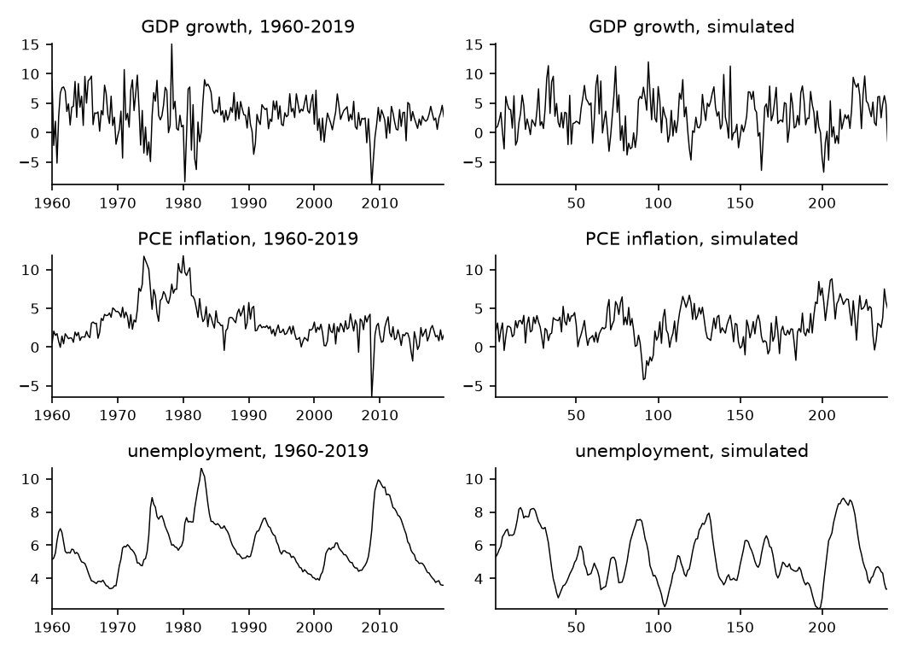

# How to Simulate Data from an Estimated VAR

*Code: [`guide.py`](guide.py), with [`bvt.util.build_lags`](../../src/bvar_toolkit/util/_build_lags.py)
and [`bvt.util.simulate_var`](../../src/bvar_toolkit/util/_simulate_var.py). Method:
[Chan (2027)](https://github.com/joshuaccchan/bvar-toolkit/blob/main/CITING.md#chan-2027).
Data: [`macro3_Q.csv`](../data/).
MATLAB version: [the same guide in bvar-toolkit](https://github.com/joshuaccchan/bvar-toolkit/tree/main/guides/var_simulation).*

The guides of this series show how to set up a VAR for forecasting, using simulated data.
Simulated data come from a known model, so every forecast can be compared with the forecast made
with the true parameters. In this guide we build the true model of the series, a VAR(4) fitted by
least squares to US real GDP growth, PCE inflation and the unemployment rate from 1960 to 2019. We
check that it is stable, compute its stationary distribution, simulate a sample with
[`bvt.util.simulate_var`](../../src/bvar_toolkit/util/_simulate_var.py), and compare it with the
data.

To print the numbers and draw the figure first, run from the root of the repository, after
`pip install -e .`:

```
python guides/var_simulation/guide.py
```

## The Data and the Model

The data file [`macro3_Q.csv`](../data/) holds 240 quarters, 1960Q1 to 2019Q4: real GDP growth and
PCE inflation as annualized percentages, and the unemployment rate in percent. The sample ends
before the pandemic. We model the three variables as a VAR with four lags:

$$\mathbf{y}_t = \mathbf{a} + \mathbf{A}_1\mathbf{y}_{t-1} + \cdots + \mathbf{A}_4\mathbf{y}_{t-4} + \boldsymbol{\varepsilon}_t, \qquad \boldsymbol{\varepsilon}_t \sim \mathcal{N}(\mathbf{0}, \boldsymbol{\Sigma}),$$

where $`\mathbf{y}_t`$ is the vector of the three variables in quarter $`t`$. To choose the number
of lags, we compare the least squares fits of VARs with one to eight lags on the same quarters,
1962Q1 to 2019Q4. The Akaike information criterion is smallest at four lags, and the Bayesian
information criterion, which penalizes additional coefficients more heavily, at two. We use four
lags, a common choice for quarterly data. We use the least squares estimates as the true
parameters, so that no prior of the later guides is correct by construction.

## Step 1: Fit the VAR

The matrix form $`\mathbf{Y} = \mathbf{Z}\mathbf{A} + \mathbf{U}`$ of
[How to Stack the Equations of a VAR](../var_stacking/) gives the estimates:

```python
D = pd.read_csv(os.path.join(os.path.dirname(HERE), 'data', 'macro3_Q.csv'),
                float_precision='round_trip')
data = D.iloc[:, 1:4].to_numpy()          # GDP growth, PCE inflation, unemployment, 1960Q1-2019Q4
p = 4
Y, Z = bvt.util.build_lags(data, p)       # y_t from 1961Q1 on; x_t = (1, y_{t-1}', ..., y_{t-4}')'
T, n = Y.shape
k = Z.shape[1]
A = np.linalg.lstsq(Z, Y, rcond=None)[0]  # least squares, A = (Z'Z)^{-1} Z'Y
U = Y - Z @ A
Sig = U.T @ U / (T - k)                   # Sig = U'U/(T - k)
```

The first four quarters serve as initial values, so $`T = 236`$. The error covariance matrix is
the residual covariance matrix with a degrees-of-freedom correction,
$`\boldsymbol{\Sigma} = \mathbf{U}'\mathbf{U}/(T - k)`$, where $`k = 13`$ is the number of
coefficients in each equation. The residual standard deviations are 2.86 for GDP growth, 1.32 for
inflation and 0.223 for unemployment. The shocks to GDP growth and unemployment have a correlation
of −0.54, consistent with Okun's law. The coefficient of the unemployment rate on its own first
lag is 1.41. A shock that raises the unemployment rate by one point raises it by 1.47 points three
quarters later and by 0.47 points after twelve quarters.

## Step 2: Check Stability and Compute the Stationary Distribution

Stacking
$`\mathbf{s}_t = (\mathbf{y}_t', \mathbf{y}_{t-1}', \mathbf{y}_{t-2}', \mathbf{y}_{t-3}')'`$
writes the VAR(4) as a VAR(1), the companion form
$`\mathbf{s}_t = \mathbf{c} + \mathbf{F}\mathbf{s}_{t-1} + \mathbf{e}_t`$. Here
$`\mathbf{c} = (\mathbf{a}', \mathbf{0}')'`$, and
$`\mathbf{e}_t = (\boldsymbol{\varepsilon}_t', \mathbf{0}')'`$ has covariance matrix
$`\mathbf{Q}`$, with $`\boldsymbol{\Sigma}`$ in its top left block and zeros elsewhere. The VAR is
stable if every eigenvalue of $`\mathbf{F}`$ has modulus below one. The eigenvalues can be
complex, and the modulus of $`a + bi`$ is $`\sqrt{a^2 + b^2}`$. A stable VAR has a stationary
distribution, under which $`\mathbf{s}_t`$ is Gaussian with mean
$`\boldsymbol{\mu} = (\mathbf{I} - \mathbf{F})^{-1}\mathbf{c}`$ and covariance matrix
$`\mathbf{V}`$, the solution of

$$\mathbf{V} = \mathbf{F}\mathbf{V}\mathbf{F}' + \mathbf{Q}.$$

```python
F = np.vstack([A[1:].T,                                   # s_t = c + F s_{t-1} + e_t
               np.hstack([np.eye(n * (p - 1)), np.zeros((n * (p - 1), n))])])
rho = np.max(np.abs(np.linalg.eigvals(F)))                # the largest modulus; stable if below one
c = np.concatenate([A[0], np.zeros(n * (p - 1))])
mu = np.linalg.solve(np.eye(n * p) - F, c)                # mu = (I - F)^{-1} c
Q = block_diag(Sig, np.zeros((n * (p - 1), n * (p - 1))))
V = np.linalg.solve(np.eye((n * p)**2) - np.kron(F, F),   # vec(V) = (I - F kron F)^{-1} vec(Q)
                    bvt.util.vec(Q)).reshape(n * p, n * p, order='F')
```

The largest modulus is 0.935, so the VAR is stable. Because it is close to one, the effects of
shocks die out slowly, as the response of unemployment in Step 1 shows. The vectorized solution
for $`\mathbf{V}`$ solves a linear system whose matrix has size $`(np)^2 \times (np)^2`$, which is
$`144 \times 144`$ here.

## Step 3: Simulate a Sample

The function [`bvt.util.simulate_var`](../../src/bvar_toolkit/util/_simulate_var.py) draws the
first four values from the stationary distribution and then runs the VAR forward with Gaussian
shocks:

```python
rng = np.random.default_rng(2)
Ysim, Y0sim = bvt.util.simulate_var(A, Sig, 240, rng=rng)   # 240 quarters, as many as in the data
```

Starting from the stationary distribution means that no burn-in is needed: every simulated
quarter, the first included, is a draw from the same distribution. Figure 1 shows the data and the
simulated sample side by side, and Table 1 compares their moments with those of the stationary
distribution.

*Table 1: The means, standard deviations and first-order autocorrelations of the data, the
simulated sample and the stationary distribution.*

| | Mean (data, simulated, stationary) | Standard deviation | First-order autocorrelation |
|---|---|---|---|
| GDP growth | 3.01, 2.91, 3.01 | 3.25, 3.43, 3.27 | 0.30, 0.38, 0.32 |
| PCE inflation | 3.18, 2.89, 3.26 | 2.54, 2.18, 2.62 | 0.82, 0.72, 0.83 |
| Unemployment | 5.97, 5.31, 5.83 | 1.61, 1.60, 1.72 | 0.97, 0.97, 0.98 |



*Figure 1: Left, US real GDP growth, PCE inflation and the unemployment rate from 1960Q1 to
2019Q4, against the year. Right, a sample of 240 quarters simulated from the VAR(4) fitted to
these data, against the quarter. The two panels of each row share one vertical scale.*

We note two differences between the data and the simulated sample. First, the volatility of GDP
growth in the data falls after the mid-1980s, while the simulated series has the same volatility
throughout, because $`\boldsymbol{\Sigma}`$ is constant. Second, the shocks are Gaussian, so
nothing bounds the simulated unemployment rate. It falls to 2.2% in quarter 198, below the lowest
rate in the data, 3.4% in 1968Q4 and 1969Q1.

## Step 4: Measure the Variation across Samples

We simulate 1,000 additional samples of 240 quarters. Across them, 90% of the sample means of
inflation lie between 2.01 and 4.55, and 90% of those of unemployment between 5.03 and 6.61. For
GDP growth the range is 2.62 to 3.38. The sample mean of a persistent series is imprecise even
over 60 years. A forecast of a persistent series reverts to the estimated mean at long horizons,
so the same uncertainty affects long-horizon forecasts. The means, standard deviations and
autocorrelations of the data all lie inside the 90% ranges of the simulated samples.

## How We Check It

<details>
<summary>The stationary covariance matrix, a long simulation and the unit test</summary>

The computed $`\mathbf{V}`$ satisfies
$`\mathbf{V} = \mathbf{F}\mathbf{V}\mathbf{F}' + \mathbf{Q}`$ to within 3e-15, relative to its
largest entry. Over 200,000 simulated quarters, the sample means, standard deviations and
first-order autocorrelations differ from those of the stationary distribution by at most 0.022,
0.008 and 0.0003. The unit test of `simulate_var` in
[`tests/test_util.py`](../../tests/test_util.py) checks it draw for draw against the MATLAB
function, on the same random numbers, both from the stationary distribution and from given
initial values.

</details>

## Adapt It Yourself

The simulation starts from the stationary distribution. How do you simulate the next 20 quarters
from the data of 2019, as a forecaster with the true parameters would?

<details>
<summary>Answer</summary>

Pass the last four quarters of the data as the initial values, the fourth argument of
`simulate_var`, and repeat for many paths:

```python
H, R = 20, 10000
paths = np.zeros((H, n, R))
rng = np.random.default_rng(4)
for r in range(R):
    paths[:, :, r] = bvt.util.simulate_var(A, Sig, H, data[-p:], rng=rng)[0]   # from 2019Q1-2019Q4
```

The unemployment rate was 3.6% in 2019Q4. Four quarters later its median is 3.87, with a 90%
interval from 2.63 to 5.07. After 20 quarters the median is 5.10, still below the stationary mean
of 5.83. Inflation moves from 1.57 to a median of 3.21 after 20 quarters, close to its stationary
mean of 3.26. That mean reflects the high inflation of the 1970s in the sample used to fit the
VAR. The paths are draws from the predictive distribution of the true model. The next guide draws
such paths from the end of the simulated sample and compares them with the forecasts of a VAR
estimated on that sample.

</details>

## Next

[How to Forecast with a Bayesian VAR](../var_forecast/) estimates a VAR on data simulated from
this model and compares its forecasts with those of the true model. The series
[Getting Started with Bayesian VARs](../README.md#getting-started-with-bayesian-vars) covers the
estimation, and [Does Modeling the Volatility Improve My Forecasts?](../../tutorials/forecasting/)
forecasts with VARs on real data.

## Using This Method in Your Research

Data simulated from an estimated model allow the results of a method to be compared with the
truth. Chan (2027) gives a textbook treatment of the VAR and its companion form.
[`CITING.md`](https://github.com/joshuaccchan/bvar-toolkit/blob/main/CITING.md) lists the paper
behind each function of the toolkit and how to cite the toolkit itself.

## References

Chan, J. C. C. (2027). *Bayesian Macroeconometrics: Methods and Applications*. Chapman &
Hall/CRC. [Code repository](https://github.com/joshuaccchan/bayesian-macroeconometrics)
