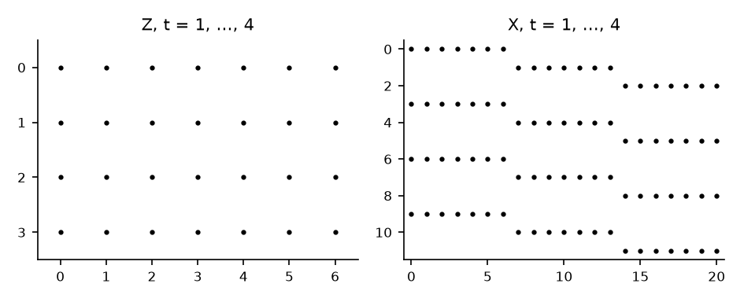

# How to Stack the Equations of a VAR

*Code: [`guide.py`](guide.py), with [`bvt.util.build_lags`](../../src/bvar_toolkit/util/_build_lags.py)
and [`bvt.util.surform2`](../../src/bvar_toolkit/util/_surform2.py). Method:
[Chan (2027)](https://github.com/joshuaccchan/bvar-toolkit/blob/main/CITING.md#chan-2027).
MATLAB version: [the same guide in bvar-toolkit](https://github.com/joshuaccchan/bvar-toolkit/tree/main/guides/var_stacking).*

A VAR is a system of regressions in which every equation has the same regressors, and it can be
stacked in two ways. The matrix form $`\mathbf{Y} = \mathbf{Z}\mathbf{A} + \mathbf{U}`$ keeps one
column per equation, and the stacked form
$`\mathbf{y} = \mathbf{X}\boldsymbol{\beta} + \boldsymbol{\varepsilon}`$ is one long linear
regression. The posterior under the natural conjugate prior is written in the first form, and
that under the independent prior in the second. In this guide we build both forms from
generated data with [`bvt.util.build_lags`](../../src/bvar_toolkit/util/_build_lags.py) and
[`bvt.util.surform2`](../../src/bvar_toolkit/util/_surform2.py), check that they give the same
likelihood, and show that least squares equation by equation is already generalized least squares
for the whole system. Then we drop regressors from one equation and see what changes. Throughout,
the coefficients are estimated by least squares; in
[How to Draw the VAR Coefficients under the Minnesota Prior](../coefficient_draw/) we place a prior
on them.

To print the numbers and draw the figure first, run from the root of the repository, after
`pip install -e .`:

```
python guides/var_stacking/guide.py
```

## The VAR

A VAR($`p`$) of $`n`$ variables is

$$\mathbf{y}_t = \mathbf{a} + \mathbf{A}_1\mathbf{y}_{t-1} + \cdots + \mathbf{A}_p\mathbf{y}_{t-p} + \boldsymbol{\varepsilon}_t, \qquad \boldsymbol{\varepsilon}_t \sim \mathcal{N}(\mathbf{0}, \boldsymbol{\Sigma}),$$

for $`t = 1, \ldots, T`$, given the initial values $`\mathbf{y}_{-p+1}, \ldots, \mathbf{y}_0`$. Each
equation has the same $`k = np + 1`$ regressors, an intercept and $`p`$ lags of every variable,
so the system has $`nk`$ coefficients. In this guide $`n = 3`$, $`p = 2`$ and $`T = 200`$, so
$`k = 7`$ and the system has 21 coefficients. `guide.py` generates the data from a stable VAR(2):
the eigenvalues of its companion matrix have modulus at most 0.868.

## Step 1: Build the Regressors

[`bvt.util.build_lags`](../../src/bvar_toolkit/util/_build_lags.py) takes the $`T + p`$ rows of
data, initial values first, and returns $`\mathbf{Y}`$, the $`T \times n`$ matrix whose row $`t`$
is $`\mathbf{y}_t'`$, and $`\mathbf{Z}`$, the $`T \times k`$ matrix whose row $`t`$ is
$`\mathbf{x}_t' = (1, \mathbf{y}_{t-1}', \ldots, \mathbf{y}_{t-p}')`$:

```python
Y, Z = bvt.util.build_lags(Yfull, p)   # T x n and T x k, k = 1 + n*p
```

The columns of $`\mathbf{Z}`$ come in the order intercept, lag-1 block, ..., lag-$`p`$ block, the
order of the rows of the coefficient matrix in Step 2.

## Step 2: The Matrix Form

Writing the VAR at time $`t`$ as a row,
$`\mathbf{y}_t' = \mathbf{x}_t'\mathbf{A} + \boldsymbol{\varepsilon}_t'`$, and stacking over
$`t`$ gives

$$\mathbf{Y} = \mathbf{Z}\mathbf{A} + \mathbf{U},$$

where $`\mathbf{A} = (\mathbf{a}, \mathbf{A}_1, \ldots, \mathbf{A}_p)'`$ is $`k \times n`$ and
row $`t`$ of $`\mathbf{U}`$ is $`\boldsymbol{\varepsilon}_t'`$. Column $`i`$ of
$`\mathbf{A}`$ holds the coefficients of equation $`i`$, and every equation has the same
regressors $`\mathbf{Z}`$. Least squares estimates all the equations at once,
$`\hat{\mathbf{A}} = (\mathbf{Z}'\mathbf{Z})^{-1}\mathbf{Z}'\mathbf{Y}`$. NumPy's `lstsq`
computes it from a singular value decomposition of $`\mathbf{Z}`$, without forming
$`\mathbf{Z}'\mathbf{Z}`$, which is more accurate when the regressors are nearly collinear:

```python
Ahat = np.linalg.lstsq(Z, Y, rcond=None)[0]   # least squares, one column per equation
U = Y - Z @ Ahat
Sighat = U.T @ U / T
```

With $`T = 200`$, the least squares estimates are within 0.220 of the true coefficients, and 0.081
away on average. The likelihood takes the trace form:

$$\log p(\mathbf{Y} \mid \mathbf{A}, \boldsymbol{\Sigma}) = -\frac{Tn}{2}\log(2\pi) - \frac{T}{2}\log|\boldsymbol{\Sigma}| - \frac{1}{2}\mathrm{tr}\left(\boldsymbol{\Sigma}^{-1}(\mathbf{Y} - \mathbf{Z}\mathbf{A})'(\mathbf{Y} - \mathbf{Z}\mathbf{A})\right).$$

## Step 3: The Stacked Form

Writing the VAR at time $`t`$ as a column instead,
$`\mathbf{y}_t = \mathbf{X}_t\boldsymbol{\beta} + \boldsymbol{\varepsilon}_t`$ with
$`\mathbf{X}_t = \mathbf{I}_n \otimes \mathbf{x}_t'`$ and
$`\boldsymbol{\beta} = \mathrm{vec}(\mathbf{A})`$, and stacking over $`t`$ gives one linear
regression,

$$\mathbf{y} = \mathbf{X}\boldsymbol{\beta} + \boldsymbol{\varepsilon}, \qquad \boldsymbol{\varepsilon} \sim \mathcal{N}(\mathbf{0}, \mathbf{I}_T \otimes \boldsymbol{\Sigma}),$$

where $`\mathbf{y} = \mathrm{vec}(\mathbf{Y}')`$ stacks $`\mathbf{y}_1, \ldots, \mathbf{y}_T`$ and
$`\mathbf{X}`$ stacks $`\mathbf{X}_1, \ldots, \mathbf{X}_T`$ into a $`Tn \times nk`$ matrix.
[`bvt.util.surform2`](../../src/bvar_toolkit/util/_surform2.py) builds $`\mathbf{X}`$ as a sparse
matrix:

```python
y = Y.ravel()                   # y = vec(Y'): y_1, ..., y_T stacked
X = bvt.util.surform2(Z, n)     # rows t*n to t*n + n - 1 hold kron(I_n, x_t')
beta = bvt.util.vec(A)          # beta = vec(A)
```

Each row of $`\mathbf{X}`$ holds one copy of $`\mathbf{x}_t'`$, in the columns of its equation
(Figure 1). Of the $`600 \times 21`$ entries of $`\mathbf{X}`$, 4,200 are nonzero, $`nk = 21`$
per period. The likelihood,

$$\log p(\mathbf{y} \mid \boldsymbol{\beta}, \boldsymbol{\Sigma}) = -\frac{Tn}{2}\log(2\pi) - \frac{T}{2}\log|\boldsymbol{\Sigma}| - \frac{1}{2}(\mathbf{y} - \mathbf{X}\boldsymbol{\beta})'(\mathbf{I}_T \otimes \boldsymbol{\Sigma}^{-1})(\mathbf{y} - \mathbf{X}\boldsymbol{\beta}),$$

is the same function of the same parameters: both forms give -770.385 at the true values and
-755.797 at the least squares values.



*Figure 1: The nonzero entries of $`\mathbf{Z}`$ (left) and of $`\mathbf{X}`$ (right) for the
first four periods. Row $`t`$ of $`\mathbf{Z}`$ is $`\mathbf{x}_t'`$; block $`t`$ of
$`\mathbf{X}`$ has $`n = 3`$ rows, and its row $`i`$ holds $`\mathbf{x}_t'`$ in the seven
columns of equation $`i`$.*

## Step 4: Generalized Least Squares and the Kronecker Shortcut

In the stacked form the errors are correlated across equations, so the efficient estimator is
generalized least squares,

$$\hat{\boldsymbol{\beta}}_{\mathrm{GLS}} = \left(\mathbf{X}'(\mathbf{I}_T \otimes \boldsymbol{\Sigma}^{-1})\mathbf{X}\right)^{-1}\mathbf{X}'(\mathbf{I}_T \otimes \boldsymbol{\Sigma}^{-1})\mathbf{y}.$$

Since every block $`\mathbf{X}_t = \mathbf{I}_n \otimes \mathbf{x}_t'`$ has the same
$`\mathbf{x}_t`$ in every equation, the two products reduce to

$$\mathbf{X}'(\mathbf{I}_T \otimes \boldsymbol{\Sigma}^{-1})\mathbf{X} = \sum_{t=1}^{T}\boldsymbol{\Sigma}^{-1} \otimes \mathbf{x}_t\mathbf{x}_t' = \boldsymbol{\Sigma}^{-1} \otimes \mathbf{Z}'\mathbf{Z}, \qquad \mathbf{X}'(\mathbf{I}_T \otimes \boldsymbol{\Sigma}^{-1})\mathbf{y} = \mathrm{vec}(\mathbf{Z}'\mathbf{Y}\boldsymbol{\Sigma}^{-1}),$$

the Kronecker shortcut (Chan, 2027). It follows that

$$\hat{\boldsymbol{\beta}}_{\mathrm{GLS}} = \left(\boldsymbol{\Sigma} \otimes (\mathbf{Z}'\mathbf{Z})^{-1}\right)\mathrm{vec}(\mathbf{Z}'\mathbf{Y}\boldsymbol{\Sigma}^{-1}) = \mathrm{vec}\left((\mathbf{Z}'\mathbf{Z})^{-1}\mathbf{Z}'\mathbf{Y}\right) = \mathrm{vec}(\hat{\mathbf{A}})$$

for any $`\boldsymbol{\Sigma}`$: least squares equation by equation is already generalized least
squares for the system. In code:

```python
W = sp.kron(sp.eye_array(T), np.linalg.inv(Sig), format='csc')   # the precision of eps
XWX = (X.T @ W @ X).toarray()   # nk x nk
XWy = X.T @ (W @ y)
bgls = np.linalg.solve(XWX, XWy)
```

`guide.py` finds `bgls` equal to `bvt.util.vec(Ahat)` for the true $`\boldsymbol{\Sigma}`$, for
$`\boldsymbol{\Sigma} = \mathbf{I}_3`$ and for a randomly drawn $`\boldsymbol{\Sigma}`$. The
shortcut also saves computation in a sampler: a Gibbs sampler under the independent prior forms
$`\mathbf{Z}'\mathbf{Z}`$ and $`\mathbf{Z}'\mathbf{Y}`$ once, outside the loop, and only
$`\boldsymbol{\Sigma}`$ changes from one iteration to the next.

## How We Check It

<details>
<summary>The checks in guide.py, which form dense matrices, practical only for a small example</summary>

`guide.py` rebuilds $`\mathbf{Y}`$ and $`\mathbf{Z}`$ by indexing the data directly and finds no
difference. $`\mathbf{X}\,\mathrm{vec}(\mathbf{A})`$ equals $`\mathrm{vec}((\mathbf{Z}\mathbf{A})')`$
to within 4e-16, and the log likelihoods of the two forms agree to the six printed decimals at
both parameter values. The two Kronecker products agree with the products formed from
$`\mathbf{X}`$ to within 8.5e-16, and the first with dense algebra to within 6.8e-16, all
relative to the largest entry. Generalized least squares equals least squares equation by equation
to within 6e-14 for all three covariance matrices.

</details>

## Adapt It Yourself

Suppose the first variable is block exogenous: its equation drops the lags of the other two
variables, as the equation of a foreign variable in a small open economy model might. How do you
estimate the restricted VAR, and is least squares equation by equation still generalized least
squares?

<details>
<summary>Answer</summary>

The matrix form still holds, with zeros in the entries of $`\mathbf{A}`$ for the dropped
coefficients, but the least squares formula $`(\mathbf{Z}'\mathbf{Z})^{-1}\mathbf{Z}'\mathbf{Y}`$
does not impose them. In the stacked form, deleting the columns of $`\mathbf{X}`$ that hold the
dropped coefficients, here columns 2, 3, 5 and 6 counting from 0, the lags of variables 2 and 3
in the block of equation 1, leaves exactly the free coefficients.

```python
keep = np.setdiff1d(np.arange(n * k), [2, 3, 5, 6])   # equation 1 drops the lags of variables 2, 3
Xr = X[:, keep]
br_gls = np.linalg.solve((Xr.T @ W @ Xr).toarray(), Xr.T @ (W @ y))
```

$`\mathbf{X}_r'(\mathbf{I}_T \otimes \boldsymbol{\Sigma}^{-1})\mathbf{X}_r`$ is no longer a
Kronecker product, and generalized least squares no longer equals least squares equation by
equation. Here it leaves the estimates of equation 1 unchanged, to within 5e-15, because the
regressors of equation 1 are a subset of those of the other two, and it moves the estimates of
equations 2 and 3 by up to 0.064. With a diagonal $`\boldsymbol{\Sigma}`$ the two estimators agree
again, to within 1e-14.

</details>

## Next

In [How to Draw the VAR Coefficients under the Minnesota Prior](../coefficient_draw/) we place a
prior on $`\boldsymbol{\beta}`$ and draw it given $`\boldsymbol{\Sigma}`$ with the shortcut of
Step 4.
Among the examples of the MATLAB toolkit,
[ex03](https://github.com/joshuaccchan/bvar-toolkit/blob/main/examples/ex03_minnesota_bvar.m)
estimates a small BVAR under the Minnesota and natural conjugate priors.

## Using This Method in Your Research

Both forms are standard, and Chan (2027) gives their textbook treatment.
[`CITING.md`](https://github.com/joshuaccchan/bvar-toolkit/blob/main/CITING.md) lists the paper
behind each function of the toolkit and how to cite the toolkit itself.

## References

Chan, J. C. C. (2027). *Bayesian Macroeconometrics: Methods and Applications*. Chapman &
Hall/CRC. [Code repository](https://github.com/joshuaccchan/bayesian-macroeconometrics)
