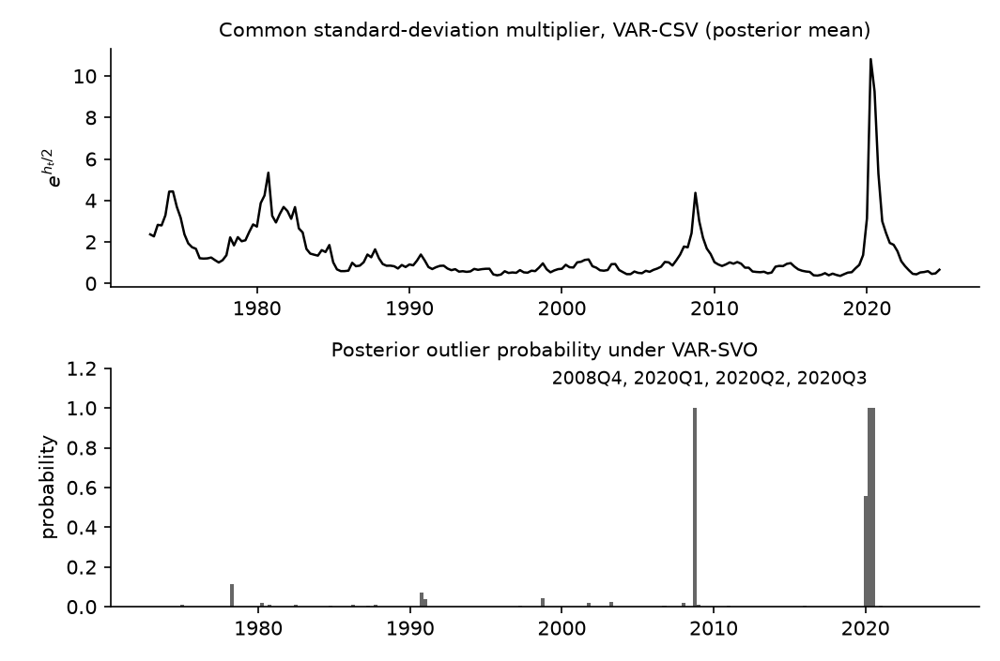

# Which Stochastic Volatility Specification Should My VAR Use?

*Code: [`build.py`](build.py) and [`your_data.py`](your_data.py), which call
[`ml_varsv.py`](ml_varsv.py) in this folder, the Python version of the driver of the Chan (2023)
replication package, and the estimators in [`bvt.ml`](../../src/bvar_toolkit/ml/). Method:
[Chan (2023)](https://github.com/joshuaccchan/bvar-toolkit/blob/main/CITING.md#chan-2023a).
MATLAB version: [the same tutorial in bvar-toolkit](https://github.com/joshuaccchan/bvar-toolkit/tree/main/tutorials/sv_specification).*

In this tutorial we compare five specifications of the error covariance matrix of a Bayesian VAR
by their marginal likelihoods: constant volatility (VAR-NCP), one common volatility factor
(VAR-CSV), one volatility process per equation under a Cholesky parameterization (VAR-SV), a few
volatility factors (VAR-FSV), and VAR-SV with an outlier component (VAR-SVO). Chan (2023)
estimates the marginal likelihoods by integrating out the VAR coefficients analytically and the
log-volatilities by adaptive importance sampling.

The application is a five-variable quarterly VAR of the unemployment rate, PCE inflation, the
federal funds rate, financial conditions and GDP growth from 1973 to 2024. VAR-SVO has the
highest log marginal likelihood, -1008.1. VAR-SV is 11.0 below it, VAR-FSV 14.3, VAR-CSV 121.5 and
VAR-NCP 579.3. The outlier component marks 2008Q4, 2020Q2 and 2020Q3 as outliers with posterior
probability 1.00, and 2020Q1 with probability 0.56.

Part of the difference between VAR-SV and VAR-CSV comes from the prior. Restricting VAR-SV to a
single shrinkage hyperparameter for own and other lags lowers its log marginal likelihood by
65.7, three fifths of the 110 between the two.

## Try It Now

Two commands, from the root of the repository, after `pip install -e ".[tutorials]"`:

| Command | What it produces | Time |
|---|---|---|
| `python tutorials/sv_specification/your_data.py` | the comparison on the same five series with short chains, and the exported report | under a minute |
| `python tutorials/sv_specification/build.py` | every number and figure on this page | 19 minutes |

The short demonstration checks that the workflow runs end to end. Its chains are far too short to
rank the specifications, and every number below comes from the full build. Its settings block is
where you point it at your own file.

On this sample the outlier specification has the highest marginal likelihood under these priors.
The ranking is conditional on the variables, the sample, the order of the variables, the priors
and the set of candidates, so the comparison is worth rerunning on any dataset before a
specification is adopted.



*Figure 1: The posterior mean of the common standard-deviation multiplier
$`\mathrm{e}^{h_t/2}`$ under VAR-CSV (top) and the posterior probability that a quarter is an
outlier under VAR-SVO (bottom), 1973Q1 to 2024Q4. The two panels come from two models, so the
figure shows which quarters each one marks and leaves open what either would do without the
other's component. The multiplier runs from 0.36 in 2018Q2 to 10.81 in 2020Q2; the outlier
probability passes one half in 2008Q4, 2020Q1, 2020Q2 and 2020Q3.*

## The Five Specifications

All five models have the same conditional mean, a reduced-form VAR with $`p`$ lags,

$$\mathbf{y}_t = \mathbf{a}_0 + \mathbf{A}_1\mathbf{y}_{t-1} + \cdots + \mathbf{A}_p\mathbf{y}_{t-p} + \boldsymbol{\varepsilon}_t, \qquad \boldsymbol{\varepsilon}_t \sim \mathcal{N}(\mathbf{0}, \boldsymbol{\Sigma}_t),$$

and differ in the covariance matrix $`\boldsymbol{\Sigma}_t`$ of the innovations and in the prior
on the VAR coefficients. Write
$`\mathbf{D}_t = \mathrm{diag}(\mathrm{e}^{h_{1t}}, \ldots, \mathrm{e}^{h_{nt}})`$ for a diagonal
matrix of volatilities.

| Model | Error covariance | Volatility processes | Shrinkage hyperparameters |
|---|---|---|---|
| VAR | $`\boldsymbol{\Sigma}`$ | none | own lag = other lag, fixed |
| VAR-CSV | $`\mathrm{e}^{h_t}\boldsymbol{\Sigma}`$ | 1 | own lag = other lag, estimated |
| VAR-SV | $`\boldsymbol{\Sigma}_t^{-1} = \mathbf{B}_0'\mathbf{D}_t^{-1}\mathbf{B}_0`$ | $`n`$ | own lags, other lags, impact matrix |
| VAR-FSV | $`\boldsymbol{\Sigma}_t = \mathbf{L}\mathbf{G}_t\mathbf{L}' + \mathbf{D}_t`$ | $`n + r`$ | own lags, other lags |
| VAR-SVO | $`\boldsymbol{\Sigma}_t^{-1} = o_t^{-2}\mathbf{B}_0'\mathbf{D}_t^{-1}\mathbf{B}_0`$ | $`n`$, and an outlier scale | own lags, other lags, impact matrix |

The homoskedastic VAR holds $`\boldsymbol{\Sigma}_t = \boldsymbol{\Sigma}`$ over the whole sample.
It has a natural conjugate prior on the coefficients and the covariance matrix, which makes its
marginal likelihood available in closed form.

VAR-CSV (Carriero, Clark and Marcellino, 2016) scales one covariance matrix by a common
volatility, $`\boldsymbol{\Sigma}_t = \mathrm{e}^{h_t}\boldsymbol{\Sigma}`$, where the
log-volatility follows a stationary AR(1) process $`h_t = \phi h_{t-1} + u_t^h`$ with
$`u_t^h \sim \mathcal{N}(0,\sigma^2)`$. Its unconditional mean is zero for identification, since
the level of the volatility is absorbed by $`\boldsymbol{\Sigma}`$. All error variances then move
in proportion, and the correlations are constant. The natural conjugate prior keeps estimation
fast even for large $`n`$.

VAR-SV, the Cholesky stochastic volatility of Cogley and Sargent (2005) and Carriero, Clark and
Marcellino (2019), gives each equation its own volatility:
$`\boldsymbol{\Sigma}_t^{-1} = \mathbf{B}_0'\mathbf{D}_t^{-1}\mathbf{B}_0`$, where
$`\mathbf{B}_0`$ is lower triangular with ones on the diagonal, and each $`h_{it}`$ follows an
AR(1) process with its own mean, persistence and variance. The $`n`$ volatilities let the
variances and the correlations move separately.

VAR-FSV takes the innovations to load on $`r`$ latent factors,
$`\boldsymbol{\varepsilon}_t = \mathbf{L}\mathbf{f}_t + \mathbf{u}_t`$, where
$`\mathbf{u}_t \sim \mathcal{N}(\mathbf{0}, \mathbf{D}_t)`$ and
$`\mathbf{f}_t \sim \mathcal{N}(\mathbf{0}, \mathbf{G}_t)`$ are independent, $`\mathbf{L}`$ is
$`n\times r`$ and lower triangular with ones on the diagonal, and $`\mathbf{G}_t`$ collects $`r`$
further volatilities. The covariance
$`\boldsymbol{\Sigma}_t = \mathbf{L}\mathbf{G}_t\mathbf{L}' + \mathbf{D}_t`$ is driven by
$`n + r`$ volatility processes.

VAR-SVO extends VAR-SV with the outlier component of Stock and Watson (2016), which Carriero,
Clark, Marcellino and Mertens (2024) use for the pandemic observations. A scale $`o_t`$ multiplies
the innovations, so $`o_t^2`$ multiplies the covariance matrix: $`o_t = 1`$ with probability
$`1 - p_o`$, and with probability $`p_o`$ it is drawn from a uniform distribution on $`(2, 20)`$,
discretized to 31 points. The outlier probability has a $`\mathcal{B}(2.5, 37.5)`$ prior,
calibrated to one outlier every four years in quarterly data. Section 14.2 of *Bayesian
Macroeconometrics* gives the same component to VAR-CSV.

Both $`\mathbf{B}_0`$ and $`\mathbf{L}`$ are unit lower triangular, so the order of the variables
is part of each specification. In VAR-FSV the first $`r`$ variables carry a loading of one, which
fixes the scale of the factors; we order the unemployment rate first, so the first factor is
normalized on a real variable, PCE inflation second for a nominal one, and GDP growth last, whose
pandemic quarters are the most extreme in the panel. The section on checking the estimates reports
what that last choice is worth.

The priors on the VAR coefficients differ with the specification, and the difference matters for
the comparison. The VAR and VAR-CSV use the natural conjugate prior, whose Kronecker structure
gives the analytical results that make them fast, and which shrinks the coefficients on own and
other lags by the same amount. The other three specifications have independent priors across
equations, which allows two shrinkage hyperparameters, one for own lags and one for lags of other
variables. Every shrinkage hyperparameter except the one of the homoskedastic VAR is estimated
with the model, under a gamma prior. We return to this difference below.

## Results for a Five-Variable VAR

The data are five quarterly US series, in the order they enter the VAR: the unemployment rate,
PCE inflation, the federal funds rate, the Chicago Fed's National Financial Conditions Index
(NFCI) and real GDP growth. Inflation and growth are annualized quarterly rates; the unemployment
rate, the federal funds rate and the NFCI are levels, with positive values of the NFCI indicating
tighter financial conditions than average. No further scaling is needed. The NFCI begins in
1971Q1, which sets the sample at 216 quarters to 2024Q4. The VAR has four lags and the first eight
quarters serve as initial conditions, so the estimation sample runs from 1973Q1 to 2024Q4, with
$`T = 208`$. Every prior mean is zero.

The priors, the lag length and the sampler settings are those of Chan (2023): the shrinkage
hyperparameters are estimated with the model, each chain keeps 20,000 draws after a burn-in of
1,000, and each marginal likelihood uses an importance sample of 10,000 draws. *Bayesian
Macroeconometrics* compares three of these specifications on the four series other than the NFCI,
by recursive one-step-ahead forecasts of inflation; here we compare five of them, with financial
conditions added, by marginal likelihood.

*Table 1: Log marginal likelihoods of the five-variable VAR, with numerical standard errors. The
last column is the difference from the best specification. VAR-NCP has no standard error: its
marginal likelihood is available in closed form.*

| Model | Log marginal likelihood | Numerical standard error | Difference |
|---|---|---|---|
| VAR-NCP | -1587.4 | | -579.3 |
| VAR-CSV | -1129.6 | 0.12 | -121.5 |
| VAR-SV | -1019.1 | 0.29 | -11.0 |
| VAR-FSV, $`r = 1`$ | -1022.4 | 0.31 | -14.3 |
| VAR-FSV, $`r = 2`$ | -1027.1 | 0.38 | -19.0 |
| VAR-SVO | -1008.1 | 0.36 | |

We note three results in the table. First, time-varying volatility matters far more than the
choice among its forms: the homoskedastic VAR is 458 below the common volatility and 579 below the
best specification. Second, the three flexible specifications exceed the common volatility by 102
to 121. That gap is between model-prior configurations, since VAR-CSV keeps the natural conjugate
prior, and for VAR-SV three fifths of it comes from the prior (Table 2). Third, adding the outlier
component to the Cholesky specification raises the log marginal likelihood by 11.0, against
numerical standard errors of 0.36 and 0.29, in a sample where GDP growth falls by 33 and rises by
30 in successive quarters.

The marginal likelihood also ranks the number of factors, and one factor beats two by 4.8. At
five variables both counts satisfy the identification condition $`r \leqslant (n-1)/2`$ of
Anderson and Rubin (1956) that Chan (2023) adopts. In the larger systems of Chan (2023) the
preferred number of factors rises with the dimension.

## How the Marginal Likelihood Is Estimated

The marginal likelihood is the density of the data under a model with all parameters integrated
out. For these models it is a high-dimensional integral over the VAR coefficients, the
log-volatilities, the latent factors and the remaining parameters, and Chan (2023) estimates it
by combining two variance-reduction techniques.

The first is conditional Monte Carlo. Given the log-volatilities and the parameters of the
covariance structure, the VAR coefficients enter a linear regression with a conjugate prior, and
for VAR-FSV the latent factors are Gaussian, so both can be integrated out analytically. What
remains is an integrated likelihood $`p(\mathbf{y}\mid\mathbf{h},\theta)`$ that can be evaluated
without simulating the VAR coefficients, which removes their contribution to the variance of the
estimate. In a large system they are the bulk of the parameters, so that contribution is the bulk
of the variance.

The second is adaptive importance sampling. The log-volatilities and the remaining parameters are
drawn from an importance density fitted to the posterior draws by the cross-entropy method of
Chan and Eisenstat (2015): a Gaussian density for each log-volatility path, parameterized as an
AR(1) process with time-varying intercepts and variances, and normal, truncated normal and gamma
densities for the other blocks. The $`M`$ weights are split into 50 batches, the estimate averages
the log of the mean weight within each batch, and their spread across batches gives the numerical
standard error. Sections 5.1.4 and 11.1.3 of *Bayesian Macroeconometrics* apply the same two
ideas to an autoregression with $`t`$ errors and to a static factor model.

The functions `bvt.ml.mlvarsv_csv`, `bvt.ml.mlvarsv_arsv_redu`, `bvt.ml.mlvarsv_fsv` and
`bvt.ml.mlvarsv_arsvo_redu` implement the estimator for VAR-CSV, VAR-SV, VAR-FSV and VAR-SVO, and
[`ml_varsv.py`](ml_varsv.py) runs the sampler of each model and passes its draws to them. The
shrinkage hyperparameters are drawn from generalized inverse Gaussian distributions by SciPy's
`geninvgauss`; the replication package uses `gigrnd`, an implementation of the algorithm of
Devroye (2014).

## Is It the Volatility or the Prior?

The five specifications differ in their priors as well as their likelihoods, and the two effects
can be separated. VAR-SV, VAR-FSV and VAR-SVO allow two shrinkage hyperparameters, one for own
lags and one for the lags of other variables, while the natural conjugate prior of the
homoskedastic VAR and VAR-CSV has a single one. Restricting VAR-SV to a single hyperparameter
gives the symmetric prior in Table 2.

*Table 2: Posterior means and standard deviations of the shrinkage hyperparameters. The symmetric
prior restricts the own-lag and other-lag hyperparameters to be equal, and VAR-CSV has one
hyperparameter for all lags.*

| Model | Log marginal likelihood | Own lags | Other lags | Impact matrix |
|---|---|---|---|---|
| VAR-CSV | -1129.6 | 0.354 (0.078) | 0.354 (0.078) | |
| VAR-SV, symmetric prior | -1084.7 | 0.0707 (0.012) | 0.0707 (0.012) | 0.0921 (0.06) |
| VAR-SV | -1019.1 | 0.244 (0.058) | 0.000868 (0.00053) | 0.0963 (0.063) |
| VAR-FSV, $`r = 1`$ | -1022.4 | 0.253 (0.059) | 0.000976 (0.00052) | |
| VAR-FSV, $`r = 2`$ | -1027.1 | 0.252 (0.059) | 0.00101 (0.00056) | |
| VAR-SVO | -1008.1 | 0.25 (0.058) | 0.00119 (0.00066) | 0.0898 (0.067) |

The restriction costs VAR-SV 65.7 in log marginal likelihood, and the estimated hyperparameters
show why: the own-lag hyperparameter is about 280 times the other-lag one, a difference the
symmetric prior cannot express. The 65.7 is three fifths of the 110 that separates VAR-SV from
VAR-CSV, so cross-variable shrinkage accounts for much of the comparison. The other two fifths is
what remains between two model-prior configurations that differ in more than their volatility
processes: VAR-CSV has the natural conjugate prior, whose Kronecker structure ties the prior on the
coefficients to the error covariance matrix, while VAR-SV has independent priors across equations
and a further hyperparameter for the impact matrix. Reading it as a pure volatility effect would
need the two priors matched first. In the 15-variable system of Chan (2023), where the number of
cross-variable coefficients is far larger, cross-variable shrinkage accounts for nearly all of the
difference, and VAR-SV under the symmetric prior fits slightly worse than VAR-CSV (Table 3 of the
paper).

## What the Outlier Component Picks Up

The outlier component gives each quarter a scale $`o_t`$ whose square multiplies the covariance
matrix, with a prior frequency of one outlier every four years. Two summaries describe how often
the posterior places an outlier. The outlier probability $`p_o`$ has a posterior mean of 0.0265,
under half the prior mean of 0.0625. The expected number of outlier quarters, the sum of the
posterior probabilities that $`o_t > 1`$, is 4.1 of 208. The beta posterior of $`p_o`$ ties the
two together as $`(2.5 + 4.1)/(40 + 208) = 0.0266`$.

Four quarters carry most of that. The component marks 2008Q4 with probability 1.00 and a posterior
mean scale of 7.7, and the two pandemic quarters 2020Q2 and 2020Q3 with probability 1.00 and scales
of 13.8 and 12.0. Since the covariance matrix is multiplied by $`o_t^2`$, those three quarters carry
about 59, 189 and 144 times the covariance the same model gives an ordinary quarter. The fourth is
2020Q1, with probability 0.56 and a scale of 3.0. Figure 1 shows the whole path beside the common
volatility of VAR-CSV, which runs from 0.36 in 2018Q2 to 10.81 in 2020Q2.

Carriero, Clark, Marcellino and Mertens (2024) design the component to keep such quarters from
lifting the persistent volatility, and Section 14.2 of *Bayesian Macroeconometrics* fits it to
the common volatility of a 25-variable monthly panel. Here it also raises the log marginal
likelihood by 11.0 over the same specification without it, which is what one would expect in a
sample whose largest observations are as extreme as these.

## Checking the Estimates

We perform three checks to assess the reliability of the log marginal likelihood estimates in
Table 1. The first is the numerical standard error of each estimate, which comes from 50 batches
of importance weights and runs from 0.12 to 0.38. The weights correct for whatever the fitted
density gets wrong, so the estimator targets the same marginal likelihood as long as that density
covers the target. How reliable a finite run is depends on the fit: a density that misses a region
can leave both the estimate and its batch standard error too small.

The second check is a repeat of every run from a second seed, which redraws the chain, refits the
importance density and redraws the weights.

*Table 3: Every specification estimated twice, from two seeds.*

| Model | Log ML, seed 1 | Log ML, seed 2 | Difference | Standard error |
|---|---|---|---|---|
| VAR-NCP | -1587.4 | -1587.4 | 0.0 | |
| VAR-CSV | -1129.6 | -1129.4 | 0.1 | 0.12 |
| VAR-SV | -1019.1 | -1018.7 | 0.4 | 0.29 |
| VAR-SV, symmetric prior | -1084.7 | -1084.7 | -0.0 | 0.34 |
| VAR-FSV, $`r = 1`$ | -1022.4 | -1022.0 | 0.4 | 0.31 |
| VAR-FSV, $`r = 2`$ | -1027.1 | -1027.3 | -0.2 | 0.38 |
| VAR-SVO | -1008.1 | -1008.4 | -0.3 | 0.36 |

No estimate moves by more than 0.4 between seeds, which leaves the ranking of Table 1 and each of
its gaps intact. The differences are of the same size as the batch standard errors, which is what
a well-behaved importance sample gives. A comparison that turned on a log point or two would need a
longer importance sample, a better-fitting density, or both.

The order of the variables matters for VAR-FSV for two related reasons. The first $`r`$ variables
identify the scales of the factors, since their loadings are fixed at one, and the model has no
outlier component, so every extreme observation has to be absorbed by its volatility processes.
Put GDP growth in the first position and the factor has to follow it through 2020Q2 and 2020Q3,
when growth falls by 33 and rises by 30: the factor's own volatility process has to swing for two
observations, and how much of that movement belongs to the factor and how much to GDP growth's
idiosyncratic volatility is poorly determined, since the unit loading ties the two together.
`build.py` estimates the one-factor model once more with GDP growth moved to the front. The same
model and the same two seeds then give -1056.1 and -1027.6, 28.6 apart, against 0.4 apart in the
order this page uses.

Ordering the series with the largest observations last leaves the factors normalized on series
whose extremes are milder, which is a matter of degree: every series here has quarters that stand
out, and the 2020 pair in GDP growth is the most extreme of them. VAR-SVO handles those quarters
with a component built for them. The normalization lies behind the dependence of VAR-SV and
VAR-SVO on the order of the variables that [the ordering tutorial](../variable_ordering/) measures
as well.

The third check is how well the chains that fit those importance densities mix. The next table
gives inefficiency factors at a truncation lag of 200, computed with `bvt.diag`, over the
hyperparameters, and the largest difference between the posterior means of the two runs.

*Table 4: Inefficiency factors by parameter group, from 20,000 draws, and the largest difference
between the posterior means of the two runs over all hyperparameters, in posterior standard
deviations.*

| Model | $`\kappa`$ | $`\mu`$ | $`\phi`$ | $`\sigma^2`$ | Largest gap between runs |
|---|---|---|---|---|---|
| VAR-CSV | 70 | | 6 | 39 | 0.06 |
| VAR-SV | 1 to 30 | 1 to 2 | 4 to 14 | 15 to 42 | 0.12 |
| VAR-SV, symmetric prior | 1 to 3 | 1 to 2 | 4 to 13 | 18 to 44 | 0.05 |
| VAR-FSV, $`r = 1`$ | 3 to 34 | 1 to 28 | 6 to 13 | 22 to 46 | 0.14 |
| VAR-FSV, $`r = 2`$ | 3 to 36 | 1 to 31 | 6 to 25 | 22 to 61 | 0.24 |
| VAR-SVO | 2 to 30 | 1 to 2 | 10 to 17 | 34 to 47 | 0.28 |

The slowest chains are the shrinkage hyperparameter of VAR-CSV, with an inefficiency factor of 70,
and the volatility variances, with factors up to 61. An inefficiency factor of 61 means that 20,000
draws carry the information of about 330 independent ones, which suffices for fitting the
importance density and is thin for a posterior standard deviation of $`\sigma_i^2`$. Even so, the
two independent runs agree on the posterior mean of every hyperparameter to within 0.28 posterior
standard deviations.

Within a run, the volatility variances drift the most in the median: between the first tenth and
the last half of a run their chains move by a median of 0.09 posterior standard deviations,
against 0.02 to 0.06 for the other groups, and the largest move of any hyperparameter is 0.45, for
a shrinkage hyperparameter. A chain several times longer is worth running before quoting their
posterior summaries. The marginal likelihoods are less affected, since they depend on the chains
only through the importance densities they fit, and they agree across runs to within 0.4. Section
6.5 of *Bayesian Macroeconometrics* sets out these diagnostics, and
[ex13 of bvar-toolkit](https://github.com/joshuaccchan/bvar-toolkit/blob/main/examples/ex13_mcmc_diagnostics.m)
applies them to a VAR-SV sampler in detail.

## Applying the Method to Your Data

The script [`your_data.py`](your_data.py) runs the same comparison on any dataset. Set the file,
the columns by name, which of them to rescale, the date column, the numbers of factors and the
chain lengths in its settings block. It drops rows missing at either end of the sample, and stops
on a missing value inside it, on unevenly spaced dates and on a constant series. With its
defaults it compares seven specifications on the five series of this page with short chains, in
under a minute, and prints the log marginal likelihoods and the quarters the outlier component picks
out. One call estimates a model and its marginal likelihood:

```python
out = ml_varsv.run_ml('VAR-SV', data, nsim=nsim, burnin=burnin, rng=seed, r=r, M=M)
```

Here `data` holds the series in columns, oldest first, with the first eight rows as initial
conditions; `out.lml` and `out.lmlstd` are the log marginal likelihood and its numerical standard
error. The arguments `is_kappafixed` and `is_kappasym` hold the shrinkage hyperparameters fixed and
impose the symmetric prior, and `r` sets the number of factors of VAR-FSV. The lag length is four
and the first eight rows are the initial conditions, as in Chan (2023), so data of another
frequency should be aggregated to quarters, as `your_data.py` does with its `rows = 'months'`
setting. The order of the columns is part of the Cholesky and factor specifications, so it is
worth choosing deliberately and repeating the comparison from a second seed.

The script writes the comparison to `outdir`, which defaults to the temporary directory so that a
run leaves the repository unchanged. `sv_specification_report_models.csv` holds one row per
specification with its log marginal likelihood, numerical standard error and running time,
`sv_specification_report_outliers.csv` the posterior outlier probability and the posterior mean
of the multiplier $`o_t`$ for each period, and `sv_specification_report.json` the settings behind
them, including the prior hyperparameters and the posterior mean of the shrinkage
hyperparameters of each model. Setting `outdir = ''` turns the export off.

## Other Implementations

The [MATLAB version of this tutorial](https://github.com/joshuaccchan/bvar-toolkit/tree/main/tutorials/sv_specification)
runs the same comparison with the replication package of Chan (2023) in bvar-toolkit. The book
repository [bayesian-macroeconometrics](https://github.com/joshuaccchan/bayesian-macroeconometrics)
implements the samplers of these models in MATLAB, R and Python: `chapter13/pred_VAR_SV` and
`pred_VAR_OISV` for the Cholesky specification and its order-invariant variant on these same four
macro series, `chapter14/pred_largeVAR_CSV`, `pred_largeVAR_SV` and `pred_largeVAR_FSV` for the
three specifications in a larger system, and `chapter14/VAR_CSV_o` for a common volatility with an
outlier component. `chapter11/SFM_CE` computes a marginal likelihood that combines an integrated
likelihood with the cross-entropy method. Those are samplers and examples of the ingredients; none
of them reproduces the comparison on this page.

## Reproducing the Results

To reproduce all results on this page, run the build script from the root of the repository:

```
python tutorials/sv_specification/build.py
```

The seven specifications are each estimated twice, and `build.py` saves a summary of every run in
a `runs` folder next to itself, so an interrupted build resumes from the last saved run. The
computation takes 19.1 minutes using Python 3.13 with NumPy 2.5 and SciPy 1.18 on a computer with
an Intel Core Ultra 7 255U processor and 32 GB of RAM. The script prints every result in this
tutorial and saves the figure in the same folder as this page. The data file
[`macro5_Q.csv`](macro5_Q.csv) joins the four series of the book's `chapter12/macro4_Q.csv` with
the NFCI column of its `chapter04/GDP_NFCI_merged.csv` on the quarter; the two files date a
quarter by its last and its first month, and the GDP column they share is identical in all 260
quarters they have in common.

The models, priors and estimators are those of the MATLAB page.
[`tests/test_drivers.py`](../../tests/test_drivers.py) runs `ml_varsv.py` beside the package's
`run_ml` on shared random numbers, with the shrinkage hyperparameters set to the mode of their
distribution in both languages, and the seven specifications agree draw for draw. The build's
chains and importance samples use NumPy's random numbers, and its shrinkage hyperparameters come
from SciPy's `geninvgauss`, so the log marginal likelihoods and the other estimates differ from the
MATLAB page within Monte Carlo error; VAR-NCP, whose marginal likelihood is in closed form, agrees.
[`PARITY.md`](../../PARITY.md) sets the two side by side.

## References

Anderson, T. W. and Rubin, H. (1956). Statistical Inference in Factor Analysis. In:
*Proceedings of the Third Berkeley Symposium on Mathematical Statistics and Probability*,
Volume 5, 111-150. University of California Press.

Carriero, A., Clark, T. E. and Marcellino, M. (2016). Common Drifting Volatility in Large
Bayesian VARs. *Journal of Business and Economic Statistics*, 34(3): 375-390.
[doi:10.1080/07350015.2015.1040116](https://doi.org/10.1080/07350015.2015.1040116)

Carriero, A., Clark, T. E. and Marcellino, M. (2019). Large Bayesian Vector Autoregressions with
Stochastic Volatility and Non-Conjugate Priors. *Journal of Econometrics*, 212(1): 137-154.
[doi:10.1016/j.jeconom.2019.04.024](https://doi.org/10.1016/j.jeconom.2019.04.024)

Carriero, A., Clark, T. E., Marcellino, M. and Mertens, E. (2024). Addressing COVID-19 Outliers
in BVARs with Stochastic Volatility. *Review of Economics and Statistics*, 106(5): 1403-1417.
[doi:10.1162/rest_a_01213](https://doi.org/10.1162/rest_a_01213)

Chan, J. C. C. (2023). Comparing Stochastic Volatility Specifications for Large Bayesian VARs.
*Journal of Econometrics*, 235(2): 1419-1446.
[doi:10.1016/j.jeconom.2022.11.003](https://doi.org/10.1016/j.jeconom.2022.11.003)

Chan, J. C. C. (forthcoming). *Bayesian Macroeconometrics: Methods and Applications*. Chapman &
Hall/CRC. [Code repository](https://github.com/joshuaccchan/bayesian-macroeconometrics)

Chan, J. C. C. and Eisenstat, E. (2015). Marginal Likelihood Estimation with the Cross-Entropy
Method. *Econometric Reviews*, 34(3): 256-285.
[doi:10.1080/07474938.2014.944474](https://doi.org/10.1080/07474938.2014.944474)

Cogley, T. and Sargent, T. J. (2005). Drifts and Volatilities: Monetary Policies and Outcomes in
the Post WWII US. *Review of Economic Dynamics*, 8(2): 262-302.
[doi:10.1016/j.red.2004.10.009](https://doi.org/10.1016/j.red.2004.10.009)

Devroye, L. (2014). Random Variate Generation for the Generalized Inverse Gaussian
Distribution. *Statistics and Computing*, 24(2): 239-246.
[doi:10.1007/s11222-012-9367-z](https://doi.org/10.1007/s11222-012-9367-z)

Stock, J. H. and Watson, M. W. (2016). Core Inflation and Trend Inflation. *Review of Economics
and Statistics*, 98(4): 770-784.
[doi:10.1162/REST_a_00608](https://doi.org/10.1162/REST_a_00608)

The BibTeX entry for Chan (2023) is in
[`CITING.md`](https://github.com/joshuaccchan/bvar-toolkit/blob/main/CITING.md) of bvar-toolkit;
those for the other papers are:

```bibtex
@inproceedings{AR56,
  author    = {Anderson, T. W. and Rubin, H.},
  title     = {Statistical Inference in Factor Analysis},
  booktitle = {Proceedings of the Third {Berkeley} Symposium on Mathematical Statistics and Probability},
  volume    = {5},
  pages     = {111--150},
  year      = {1956},
  publisher = {University of California Press}
}

@article{CCM16,
  author  = {Carriero, A. and Clark, T. E. and Marcellino, M.},
  title   = {Common Drifting Volatility in Large {Bayesian} {VARs}},
  journal = {Journal of Business and Economic Statistics},
  year    = {2016},
  volume  = {34},
  number  = {3},
  pages   = {375--390},
  doi     = {10.1080/07350015.2015.1040116}
}

@article{CCM19,
  author  = {Carriero, A. and Clark, T. E. and Marcellino, M.},
  title   = {Large {Bayesian} Vector Autoregressions with Stochastic Volatility and Non-Conjugate Priors},
  journal = {Journal of Econometrics},
  year    = {2019},
  volume  = {212},
  number  = {1},
  pages   = {137--154},
  doi     = {10.1016/j.jeconom.2019.04.024}
}

@article{CCMM24,
  author  = {Carriero, A. and Clark, T. E. and Marcellino, M. and Mertens, E.},
  title   = {Addressing {COVID-19} Outliers in {BVARs} with Stochastic Volatility},
  journal = {Review of Economics and Statistics},
  year    = {2024},
  volume  = {106},
  number  = {5},
  pages   = {1403--1417},
  doi     = {10.1162/rest_a_01213}
}

@article{CE15,
  author  = {Chan, J. C. C. and Eisenstat, E.},
  title   = {Marginal Likelihood Estimation with the Cross-Entropy Method},
  journal = {Econometric Reviews},
  year    = {2015},
  volume  = {34},
  number  = {3},
  pages   = {256--285},
  doi     = {10.1080/07474938.2014.944474}
}

@article{CS05,
  author  = {Cogley, T. and Sargent, T. J.},
  title   = {Drifts and Volatilities: Monetary Policies and Outcomes in the Post {WWII} {US}},
  journal = {Review of Economic Dynamics},
  year    = {2005},
  volume  = {8},
  number  = {2},
  pages   = {262--302},
  doi     = {10.1016/j.red.2004.10.009}
}

@article{Dev14,
  author  = {Devroye, L.},
  title   = {Random Variate Generation for the Generalized Inverse {Gaussian} Distribution},
  journal = {Statistics and Computing},
  year    = {2014},
  volume  = {24},
  number  = {2},
  pages   = {239--246},
  doi     = {10.1007/s11222-012-9367-z}
}

@article{SW16,
  author  = {Stock, J. H. and Watson, M. W.},
  title   = {Core Inflation and Trend Inflation},
  journal = {Review of Economics and Statistics},
  year    = {2016},
  volume  = {98},
  number  = {4},
  pages   = {770--784},
  doi     = {10.1162/REST_a_00608}
}
```
